# Lab 4: Dự báo điện năng đa biến bằng VAR, XGBoost và LSTM

Repo: [github.com/thanh1912-ut/lab4-time](https://github.com/thanh1912-ut/lab4-time)

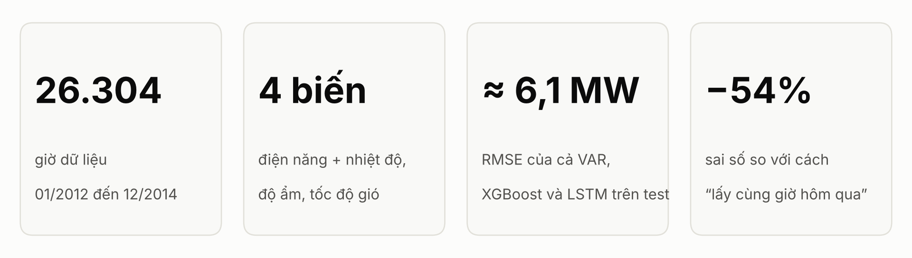

> **Cách đọc bảng:** ↓ là giảm, ↑ là tăng. Với sai số (RMSE, MAE, MAPE), **↓ là tốt hơn**. Tiêu đề cột có "↓" nghĩa là càng thấp càng tốt. Phần trăm tính so với dòng ghi **mốc** trong cùng bảng. Đơn vị RMSE và MAE là MW.

## Tóm tắt

| Con số | Ý nghĩa |
|---|---|
| **26.304 giờ** | Dữ liệu theo giờ từ 01/2012 đến 12/2014, gồm 4 biến |
| **70 / 15 / 15** | Chia theo thời gian: train 18.412 giờ, validation 3.946 giờ, test 3.946 giờ |
| **0,66** | Tương quan giữa nhiệt độ và điện năng, mạnh nhất trong 3 biến thời tiết (riêng mùa hè 0,72) |
| **6,07 / 6,17 / 6,14 MW** | RMSE trên test của VAR / XGBoost / LSTM |
| **420 / 154 cây / 30.113** | Số tham số của VAR / XGBoost / LSTM |
| **↓54%** | Sai số của cả 3 mô hình so với cách "lấy cùng giờ hôm qua" (13,42 MW) |
| **13,96 → 6,14 (↓56%)** | RMSE của LSTM khi chuyển từ train theo thứ tự thời gian sang xáo trộn mẫu train |
| **5,89–6,28** | Khoảng RMSE của LSTM khi chỉ đổi seed, rộng hơn khoảng cách giữa 3 mô hình |
| **5,36 MW (↓12%)** | RMSE khi lấy trung bình dự báo của 3 mô hình, thấp hơn mô hình tốt nhất 12% |
| **↑50 lần** | Thời gian học của LSTM so với XGBoost (145 giây so với 2,9 giây) |

---

## 1. Bài toán và dữ liệu

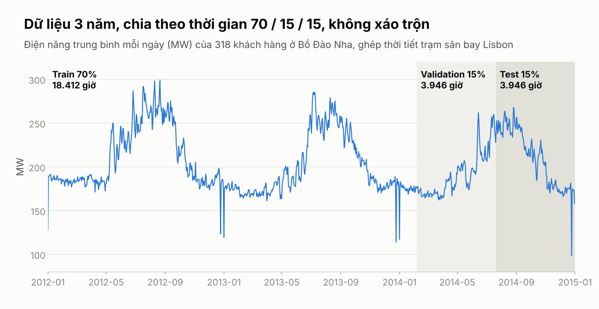

- **Bài toán:** tại mỗi giờ t có vector X_t = [load, temperature, humidity, wind_speed]. Dùng **24 giờ gần nhất** để dự báo **load của giờ t+1**.
- **Điện năng:** UCI ElectricityLoadDiagrams20112014, tổng của **318 khách hàng** ở Bồ Đào Nha, trung bình **203 MW**.
- **Thời tiết:** bộ UCI **không có thời tiết**, nên nhóm ghép thêm nhiệt độ, độ ẩm, gió thật của trạm sân bay Lisbon (NOAA ISD), cùng khu vực và cùng thời gian.
- **Sau khi ghép:** **26.304 giờ**, từ 01/01/2012 đến 31/12/2014, không thiếu giờ nào.
- **Chuẩn hóa:** StandardScaler chỉ fit trên train, dùng chung cho cả 3 mô hình.

| Tập | Số giờ | Tỷ lệ | Từ | Đến |
|---|---:|---:|---|---|
| Train | 18.412 | 70% | 01/01/2012 | 06/02/2014 |
| Validation | 3.946 | 15% | 06/02/2014 | 20/07/2014 |
| Test | 3.946 | 15% | 20/07/2014 | 31/12/2014 |

Chia theo thời gian, không xáo trộn khi chia tập.

---

## 2. Hiểu dữ liệu

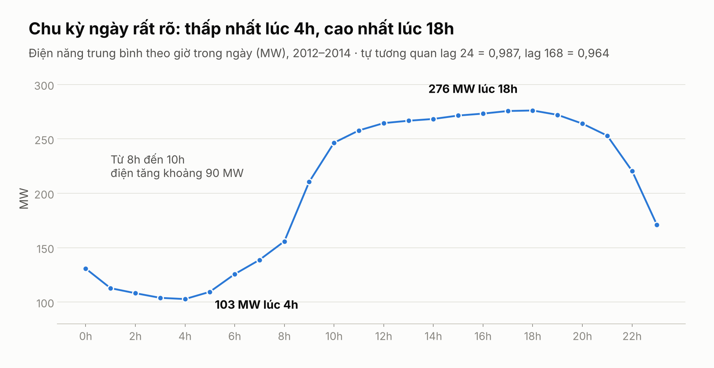

| Kiểm tra | Kết quả |
|---|---|
| Giá trị thiếu | **0** ở cả 4 biến |
| Ngoại lai của load (IQR) | **9 điểm** (0,03%) |
| Giờ thấp nhất / cao nhất | **4h: 103 MW** / **18h: 276 MW** (↑2,7 lần) |
| Buổi sáng | Từ 8h đến 10h: **↑ khoảng 90 MW** |
| Tự tương quan lag 24 giờ | **0,987**, chu kỳ ngày rất mạnh |
| Tự tương quan lag 168 giờ | **0,964**, chu kỳ tuần cũng mạnh |

Chu kỳ ngày gần như lặp lại hoàn toàn, nên cửa sổ 24 giờ là hợp lý.

---

## 3. Câu 1: Biến thời tiết nào ảnh hưởng mạnh nhất?

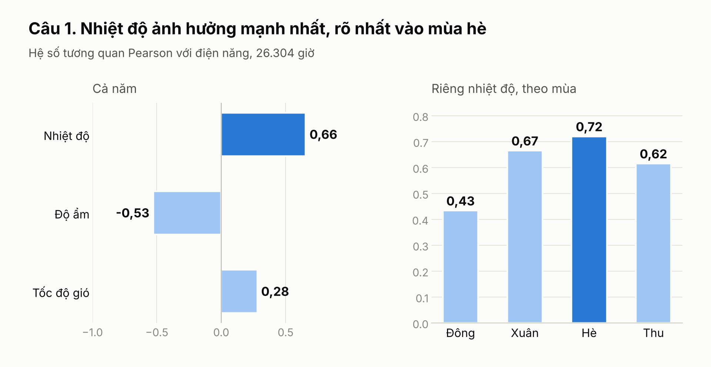

| Biến | Pearson | Spearman | Chiều quan hệ |
|---|---:|---:|---|
| **Nhiệt độ** | **0,66** | **0,59** | Nhiệt độ ↑ thì điện ↑ (mạnh nhất) |
| Độ ẩm | −0,53 | −0,49 | Độ ẩm ↑ thì điện ↓ |
| Tốc độ gió | 0,28 | 0,30 | Gió ↑ thì điện ↑ (yếu) |

| Tương quan nhiệt độ – điện theo mùa | Đông | Xuân | Hè | Thu |
|---|---:|---:|---:|---:|
| Pearson | 0,43 | 0,67 | **0,72** | 0,62 |

- **Nhiệt độ ảnh hưởng mạnh nhất**, rõ nhất vào **mùa hè**, phù hợp với nhu cầu dùng điều hòa khi trời nóng.
- Độ ẩm có hệ số âm một phần vì độ ẩm thường thấp khi trời nóng (tương quan nhiệt độ – độ ẩm là −0,57).
- XGBoost cho cùng thứ hạng theo Gain: nhiệt độ > độ ẩm > gió.
- Đây là **tương quan thống kê**, chưa khẳng định quan hệ nhân quả.

---

## 4. Tham số các mô hình và luật so sánh công bằng

| | VAR | XGBoost | LSTM |
|---|---|---|---|
| Nhóm mô hình | Thống kê, tuyến tính | Học máy, cây tăng cường | Học sâu, mạng hồi quy |
| Đầu vào | Chuỗi 4 biến, 26 giờ trễ | Vector phẳng **99 cột**: 96 lag (24 giờ × 4 biến) + rolling mean 6h, rolling std 24h, xu hướng 24h | Tensor 3D **(mẫu, 24, 4)** |
| Đã thử | p từ 1 đến 48 | max_depth ∈ {3, 5, 7, 9} | patience ∈ {5, 10}, mỗi giá trị 3 seed |
| Cách chọn | BIC trên train | RMSE validation | RMSE validation trung bình 3 seed |
| **Cấu hình chọn** | **p = 26**, có hệ số chặn | **max_depth = 7**, learning_rate = 0,05, tối đa 2.000 cây, early stopping 50 vòng, seed 42 | **LSTM(64) → LSTM(32) → Dense(1)**, Adam lr = 0,001, loss MSE, batch 64, tối đa 50 epoch, **patience = 10**, xáo trộn mẫu train, seed 42 |
| Khi học xong | VAR(26) ổn định | Dừng ở **154 cây** (16.049 lá) | Dừng ở epoch 26, giữ trọng số **epoch 16** |
| **Số tham số** | **420** = 4 × (4 × 26 + 1) | **154 cây, 16.049 lá** | **30.113** = 17.664 + 12.416 + 33 |
| Thời gian học 1 lần ↓ | **0,1 giây** | 2,9 giây | 145 giây (↑50 lần so với XGBoost) |
| Chạy lại ra cùng kết quả | Có | Có | Không, dao động theo seed |
| **Test RMSE ↓** | **6,07** | 6,17 | 6,14 |

**Cả 3 mô hình theo cùng một luật:**
- Học trên train, chọn cấu hình bằng validation.
- **Không học lại trên test**; test chỉ dùng để chấm điểm.
- **Walk-forward:** mỗi giờ test dự báo 1 bước, sau đó đưa **giá trị thật** của giờ đó vào chuỗi rồi dự báo giờ tiếp theo.
- Cách đưa **giá trị dự báo** vào chuỗi (dự báo nhiều bước) được thử riêng ở Câu 2 và Câu 4.

---

## 5. VAR

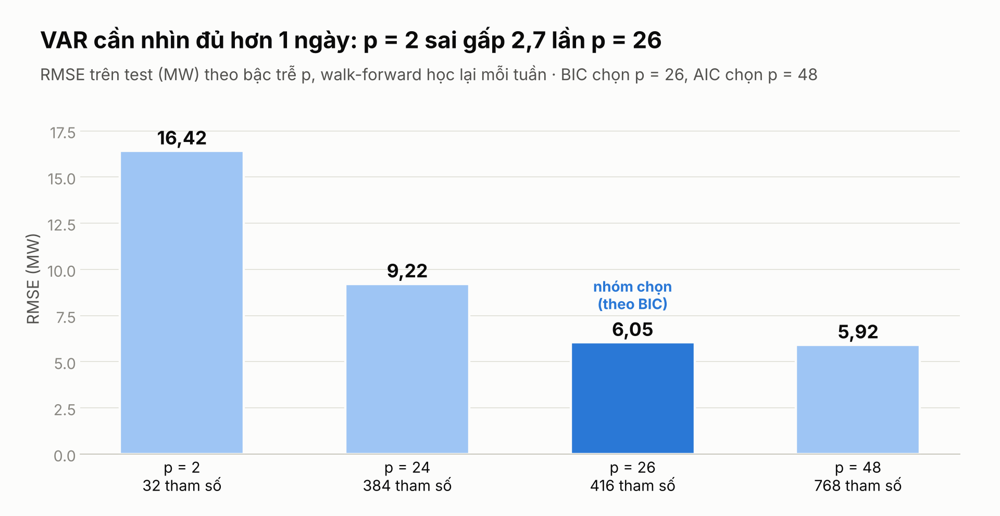

- **ADF:** cả 4 biến đều dừng (p của load = 0,017), nên **không cần sai phân**.
- **Chọn bậc trễ:** AIC chọn p = 48, **BIC chọn p = 26**. Nhóm dùng **VAR(26)**.
- Với p = 26, VAR thấy được cả cùng giờ hôm qua lẫn mức thay đổi của điện năng ở giờ đó hôm qua.
- VAR dự báo cả vector 4 biến, chỉ đánh giá load.

| Bậc trễ p | Số hệ số (4×4×p) | Test RMSE ↓ | So với p = 26 |
|---|---:|---:|---|
| 2 | 32 | 16,42 | ↑171% |
| 24 | 384 | 9,22 | ↑52% |
| **26 (BIC chọn)** | **416** | **6,05** | **mốc** |
| 48 (AIC chọn) | 768 | 5,92 | ↓2,1%, nhưng số hệ số ↑85% |

*Bảng này dùng walk-forward học lại mỗi tuần.*

| VAR(26) | RMSE ↓ | MAE ↓ | MAPE (%) ↓ |
|---|---:|---:|---:|
| Học 1 lần (**mốc**) | **6,07** | 4,11 | 2,06 |
| Học lại mỗi tuần | 6,05 (↓0,3%) | 4,06 (↓1,2%) | 2,03 (↓1,5%) |

---

## 6. Câu 2: Khi nào VAR thất bại?

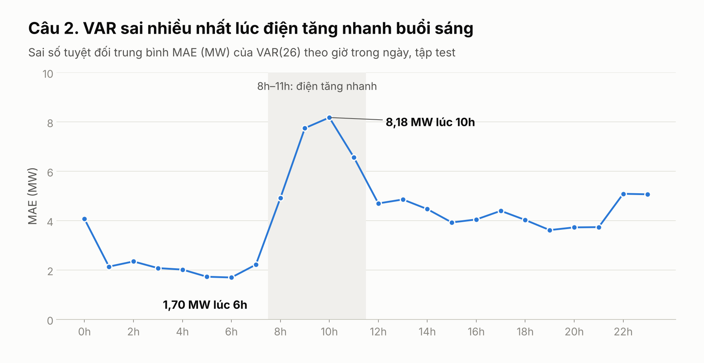

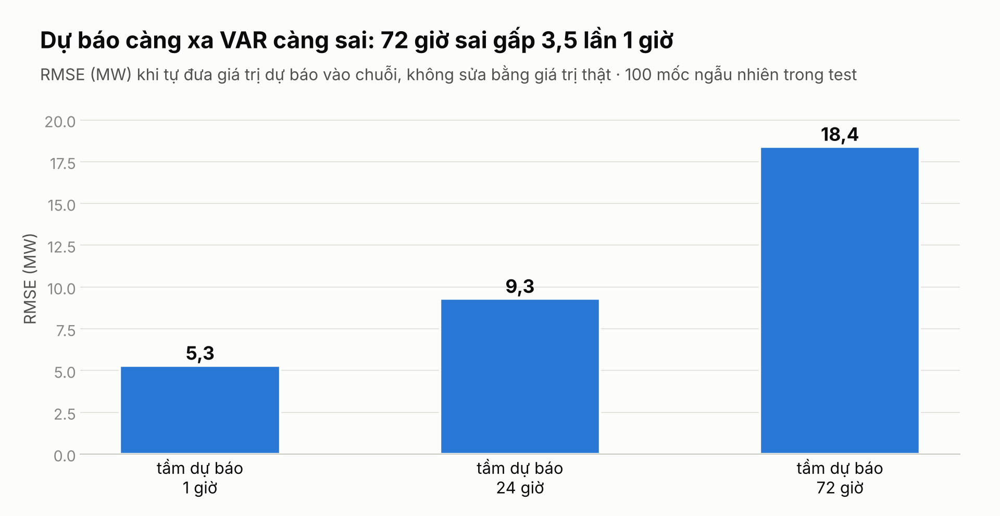

| Tình huống | Số liệu | Mức tăng sai số |
|---|---|---|
| Điện thay đổi nhanh buổi sáng | MAE lúc **10h: 8,18** so với **6h: 1,70** | ↑4,8 lần |
| Ngày lễ | **6/10 giờ** sai nhiều nhất rơi vào 24–31/12 | |
| p quá nhỏ | p = 2: RMSE 16,42 so với p = 26: 6,05 | ↑171% |

| Tầm dự báo (đưa giá trị dự báo vào chuỗi) | RMSE ↓ | So với 1 giờ |
|---|---:|---|
| 1 giờ (**mốc**) | 5,3 | **mốc** |
| 24 giờ | 9,3 | ↑75% |
| 72 giờ | 18,4 | ↑247% |

1. **Khi điện thay đổi nhanh:** VAR là mô hình tuyến tính nên khó theo kịp đoạn tăng nhanh buổi sáng.
2. **Vào ngày lễ:** VAR chỉ nhìn 26 giờ trước nên không biết hôm đó là ngày nghỉ.
3. **Khi dự báo xa:** không có giá trị thật để sửa nên sai số cộng dồn.
4. **Khi p quá nhỏ:** p = 2 không chứa được chu kỳ ngày.

---

## 7. XGBoost

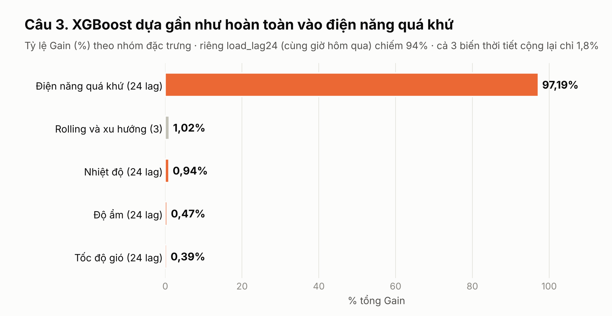

| max_depth | Số cây (early stopping) | Validation RMSE ↓ | So với max_depth = 7 |
|---:|---:|---:|---|
| 3 | 665 | 4,69 | ↑3,8% |
| 5 | 264 | 4,55 | ↑0,7% |
| **7** | **154** | **4,52** | **mốc** |
| 9 | 276 | 4,65 | ↑2,9% |

- learning_rate = 0,05, tối đa 2.000 cây, early stopping 50 vòng trên validation.
- **97%** Gain đến từ điện năng quá khứ; riêng `load_lag24` (cùng giờ hôm qua) chiếm **94%**.
- Cả 3 biến thời tiết cộng lại chỉ **1,8%** Gain.

| XGBoost | RMSE ↓ | MAE ↓ | MAPE (%) ↓ |
|---|---:|---:|---:|
| Học 1 lần (**mốc**) | 6,17 | **3,81** | **1,89** |
| Học lại mỗi tuần | 6,07 (↓1,6%) | 3,71 (↓2,6%) | 1,86 (↓1,6%) |

XGBoost có MAE và MAPE thấp nhất trong 3 mô hình.

---

## 8. Câu 3: XGBoost học được gì từ thời tiết?

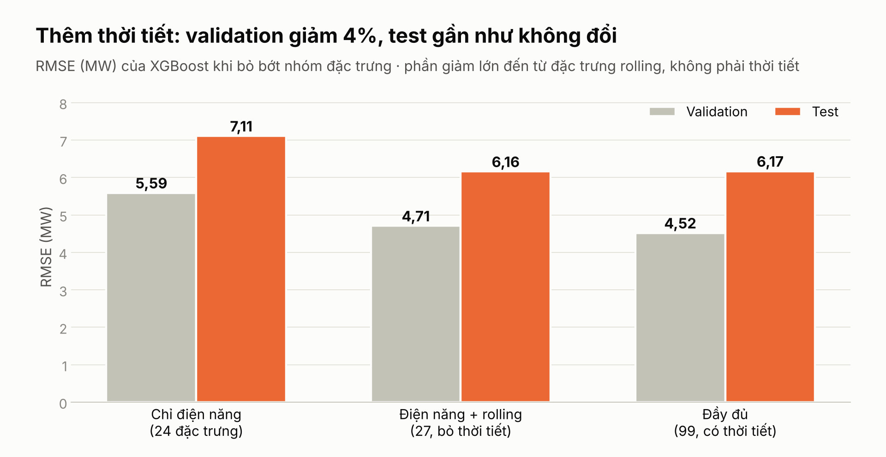

| Cấu hình | Số đặc trưng | Validation RMSE ↓ | Test RMSE ↓ |
|---|---:|---:|---:|
| Chỉ điện năng (**mốc**) | 24 | 5,59 | 7,11 |
| + rolling | 27 | 4,71 (↓15,7%) | 6,16 (↓13,4%) |
| + thời tiết (đầy đủ) | 99 | 4,52 (↓4,0%) | 6,17 (↑0,2%) |

*Phần trăm tính so với dòng ngay phía trên.*

- **Nhiệt độ là biến thời tiết quan trọng nhất**, Gain gấp 2 lần độ ẩm và gấp 2,4 lần gió.
- **Quan hệ phi tuyến:** theo PDP, khi nhiệt độ **trên khoảng 20 °C** thì dự báo ↑ dần, tới **+2,6 MW** ở 25–27 °C (dạng chữ J). VAR tuyến tính không học được dạng này.
- **Đóng góp của thời tiết nhỏ:** validation ↓4%, test gần như không đổi. Phần giảm lớn đến từ **đặc trưng rolling**.
- Có thể vì điện năng hôm qua đã chứa phần lớn thông tin thời tiết, do nhiệt độ thay đổi khá chậm giữa các ngày.

---

## 9. LSTM

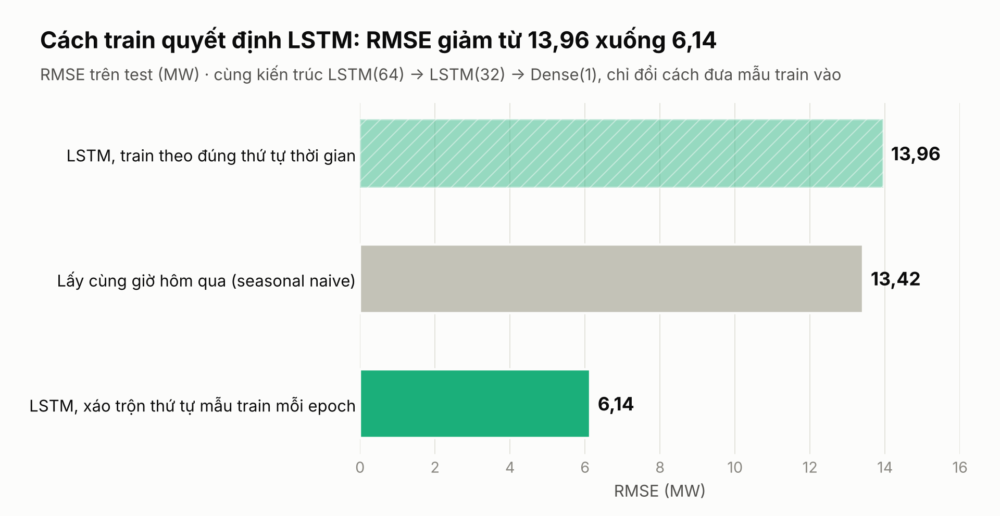

- **Kiến trúc đúng đề:** LSTM(64) → LSTM(32) → Dense(1), **30.113 tham số**, loss MSE, Adam lr = 0,001, batch 64.
- **Đầu vào:** tensor 3D (18.388, 24, 4).

| Cách train | Test RMSE ↓ | So với train theo thứ tự |
|---|---:|---|
| Train theo đúng thứ tự thời gian (**mốc**) | 13,96 | **mốc**, kém cả cách lấy cùng giờ hôm qua (13,42) |
| Xáo trộn mẫu train mỗi epoch, seed 42 | **6,14** | **↓56%** |
| Xáo trộn, trung bình 5 seed | 6,05 ± 0,16 | ↓57% |

| patience | Validation RMSE TB 3 seed ↓ | So với patience = 5 |
|---:|---:|---|
| 5 (**mốc**) | 6,17 | **mốc** |
| **10 (chọn)** | **5,87** | ↓4,9% |

- **Không vi phạm yêu cầu "không shuffle":** tập dữ liệu vẫn chia theo thời gian. Chỉ đổi thứ tự các cửa sổ **bên trong tập train**; mỗi cửa sổ đã cố định 24 giờ quá khứ, validation và test giữ nguyên thứ tự, nên không lộ dữ liệu tương lai.
- Một cách giải thích: nếu train theo thứ tự, các batch cuối mỗi epoch luôn là mùa đông (cuối tập train là tháng 12 đến tháng 2), nên mô hình dễ bị kéo lệch về mùa đông.
- Mô hình chính: **RMSE 6,14 · MAE 4,39 · MAPE 2,25%**, dừng ở epoch 26, giữ trọng số epoch 16.

---

## 10. Câu 4: LSTM học được chu kỳ nào?

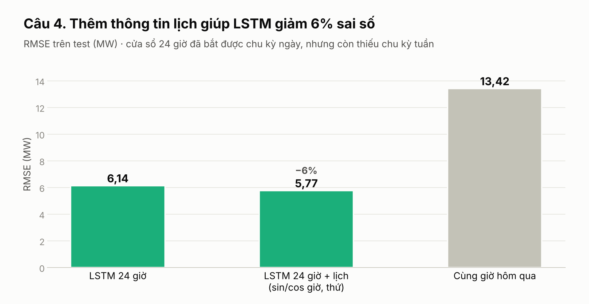

| Đầu vào | Test RMSE ↓ | MAE ↓ | MAPE (%) ↓ |
|---|---:|---:|---:|
| LSTM 24 giờ (**mốc**) | 6,14 | 4,39 | 2,25 |
| LSTM 24 giờ + lịch (sin/cos giờ, thứ) | **5,77 (↓6,0%)** | 3,98 (↓9,3%) | 2,04 (↓9,3%) |

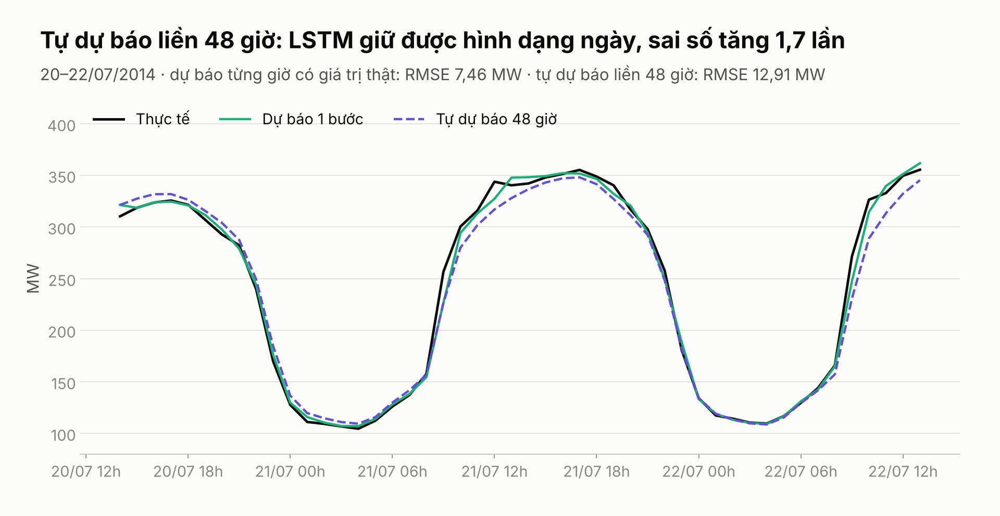

| Cách dự báo (20–22/07/2014) | RMSE ↓ | So với 1 bước |
|---|---:|---|
| Dự báo 1 bước, có giá trị thật từng giờ (**mốc**) | 7,46 | **mốc** |
| Tự dự báo liền 48 giờ | 12,91 | ↑73% |

- **Chu kỳ ngày: học được.** Khi tự dự báo liền 48 giờ, đường dự báo vẫn giữ đúng hình dạng lên xuống trong ngày.
- **Chu kỳ tuần: chưa đủ.** Cửa sổ 24 giờ không thấy được thứ trong tuần; thêm thông tin lịch làm sai số ↓6%.

---

## 11. Câu 5: LSTM có overfitting không?

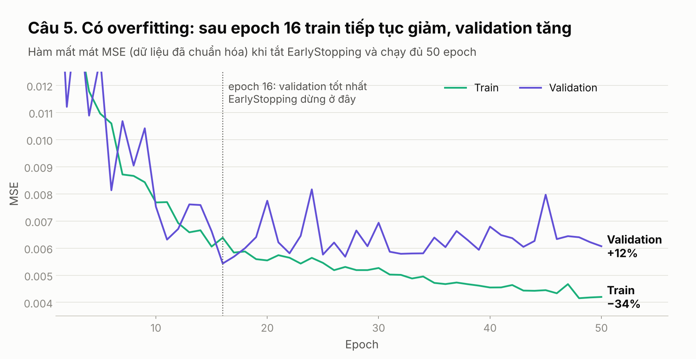

| | Epoch | Train RMSE | Validation RMSE ↓ | Test RMSE ↓ |
|---|---:|---:|---:|---:|
| LSTM + EarlyStopping (**mốc**) | 26 | 6,02 | **5,90** | 6,14 |
| Chạy đủ 50 epoch, không EarlyStopping | 50 | 5,31 (↓11,8%) | 6,23 (↑5,6%) | 5,92 (↓3,6%) |
| + Dropout(0,2) + EarlyStopping | 40 | 6,07 (↑0,8%) | 6,15 (↑4,2%) | 6,03 (↓1,8%) |

- **Có overfitting** khi chạy đủ 50 epoch: từ epoch 16 đến 50, train loss **↓34%** trong khi validation loss **↑12%**. Train ↓ mà validation ↑ chính là dấu hiệu overfitting.
- **EarlyStopping** theo validation dừng đúng ở epoch 16 và giữ trọng số tốt nhất.
- Bản 50 epoch có test thấp hơn một chút, nhưng mô hình phải chọn theo validation, không được chọn theo test.

---

## 12. So sánh ba mô hình

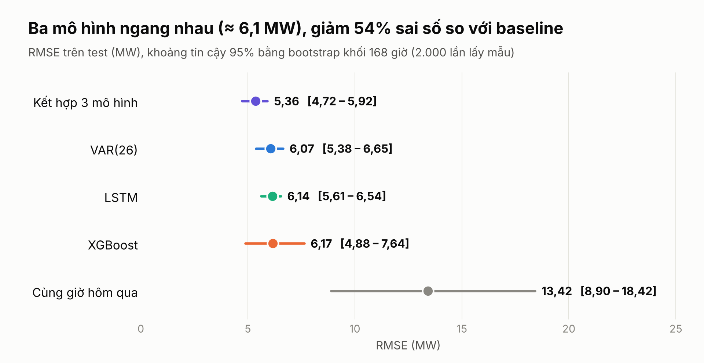

Test 3.946 giờ, cả 3 mô hình theo cùng luật ở mục 4.

| Mô hình | Số tham số | Thời gian học ↓ | RMSE ↓ | MAE ↓ | MAPE (%) ↓ | RMSE so với cùng giờ hôm qua |
|---|---:|---:|---:|---:|---:|---|
| Lấy giờ trước (naive) | 0 | 0 | 25,50 | 16,34 | 8,78 | ↑90% |
| Lấy cùng giờ hôm qua (**mốc**) | 0 | 0 | 13,42 | 7,68 | 3,82 | **mốc** |
| VAR(26) | 420 | **0,1 giây** | **6,07** | 4,11 | 2,06 | ↓54,8% |
| XGBoost | 154 cây | 2,9 giây | 6,17 | **3,81** | **1,89** | ↓54,0% |
| LSTM | 30.113 | 145 giây | 6,14 | 4,39 | 2,25 | ↓54,2% |
| Kết hợp 3 mô hình | cả 3 | 148 giây | *5,36* | *3,61* | *1,80* | ↓60,0% |

| Tiêu chí | Hạng 1 | Hạng 2 | Hạng 3 |
|---|---|---|---|
| RMSE ↓ | VAR 6,07 | LSTM 6,14 | XGBoost 6,17 |
| MAE ↓ | XGBoost 3,81 | VAR 4,11 | LSTM 4,39 |
| MAPE ↓ | XGBoost 1,89 | VAR 2,06 | LSTM 2,25 |
| Số tham số ↓ | VAR 420 | XGBoost 154 cây | LSTM 30.113 |
| Thời gian học ↓ | VAR 0,1 giây | XGBoost 2,9 giây | LSTM 145 giây |
| RMSE ngày lễ ↓ | LSTM 8,57 | VAR 9,43 | XGBoost 14,25 |

- Hạng 1 và hạng 3 về RMSE chỉ chênh **0,11 MW (1,8%)**; khoảng tin cậy 95% (bootstrap khối 168 giờ, 2.000 lần) chồng lên nhau.
- **Kiểm định Diebold–Mariano:** với sai số bình phương, **không có cặp nào khác biệt có ý nghĩa**. Với sai số tuyệt đối, XGBoost tốt hơn LSTM (p = 0,0002) và VAR (p = 0,01).
- **Kết hợp 3 mô hình** (lấy trung bình dự báo, không học thêm): **5,36 MW, ↓12%** so với mô hình tốt nhất. Mức cải thiện so với VAR và LSTM có ý nghĩa thống kê, so với XGBoost thì chưa đủ chắc chắn.
- **Học lại mỗi tuần gần như không giúp gì:** VAR ↓0,3%, XGBoost ↓1,6%.

---

## 13. Mỗi mô hình mạnh ở đâu?

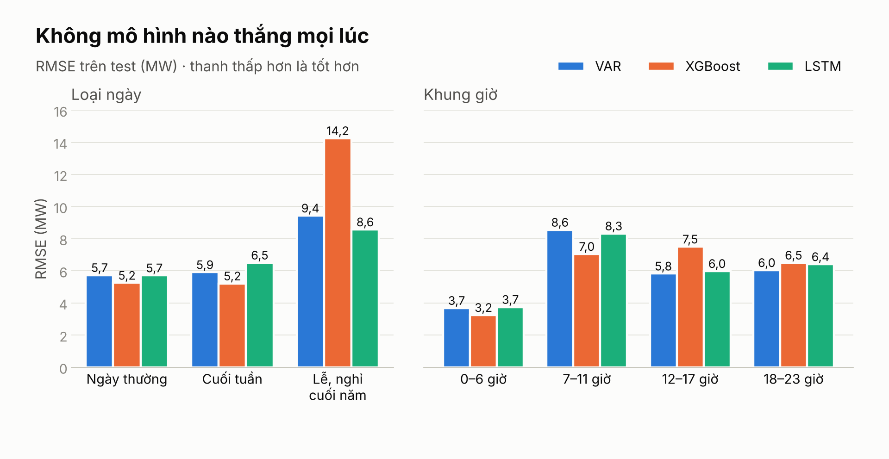

| RMSE ↓ (thấp nhất in đậm) | Số giờ | VAR | XGBoost | LSTM |
|---|---:|---:|---:|---:|
| Ngày thường | 2.640 | 5,73 | **5,25** | 5,71 |
| Cuối tuần | 1.066 | 5,91 | **5,21** | 6,51 |
| Lễ, nghỉ cuối năm | 240 | 9,43 | 14,25 | **8,57** |
| *Lễ so với ngày thường* | | *↑65%* | *↑171%* | *↑50%* |
| 0–6 giờ | 1.148 | 3,68 | **3,25** | 3,75 |
| 7–11 giờ | 820 | 8,55 | **7,05** | 8,32 |
| 12–17 giờ | 988 | **5,83** | 7,50 | 5,98 |
| 18–23 giờ | 990 | **6,04** | 6,51 | 6,41 |

- **Ngày lễ:** XGBoost ↑171% so với ngày thường, nặng nhất trong 3 mô hình. Có thể vì XGBoost dựa quá nhiều vào cùng giờ hôm qua, mà ngày lễ khác hẳn hôm trước.
- **XGBoost** tốt nhất ở ngày thường, cuối tuần, ban đêm và buổi sáng. **VAR** tốt nhất buổi chiều và tối. **LSTM** tốt nhất ngày lễ.
- Cách lấy cùng giờ hôm qua sai tới **38,4 MW** vào ngày lễ.
- Không mô hình nào thắng mọi lúc, nên kết hợp 3 mô hình cho kết quả tốt hơn từng mô hình riêng lẻ.

---

## 14. Độ ổn định của kết quả

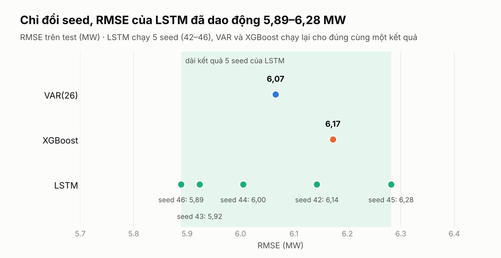

| Seed LSTM | Epoch dừng | Epoch được giữ | Test RMSE ↓ | So với seed 42 |
|---:|---:|---:|---:|---|
| 42 (**mốc**) | 26 | 16 | 6,14 | **mốc** |
| 43 | 50 | 43 | 5,92 | ↓3,6% |
| 44 | 36 | 26 | 6,00 | ↓2,2% |
| 45 | 19 | 9 | 6,28 | ↑2,3% |
| 46 | 32 | 22 | 5,89 | ↓4,1% |
| **Trung bình** | | | **6,05 ± 0,16** | |

- Dải kết quả của LSTM (5,89–6,28) **phủ cả VAR (6,07) và XGBoost (6,17)**.
- VAR và XGBoost chạy lại cho đúng cùng một kết quả.
- Vì vậy không thể xếp hạng 3 mô hình chỉ dựa vào một lần chạy LSTM.

---

## 15. Câu 6: Khác biệt giữa học máy và học sâu

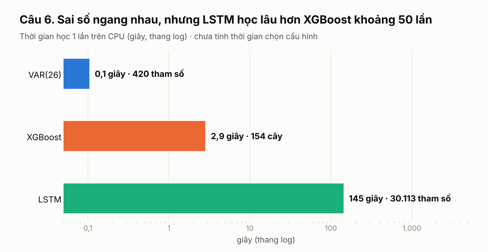

| | XGBoost (học máy) | LSTM (học sâu) | LSTM so với XGBoost |
|---|---|---|---|
| Đầu vào | Vector phẳng 99 cột, đặc trưng phải tự tạo | Tensor 3D (24, 4), tự học biểu diễn theo thời gian | |
| Chuẩn hóa | Không bắt buộc | Bắt buộc | |
| Số tham số | 154 cây, 16.049 lá | 30.113 | |
| Siêu tham số chọn | max_depth = 7, learning_rate = 0,05 | patience = 10, lr = 0,001, batch 64 | |
| Test RMSE ↓ | 6,17 | **6,14** | ↓0,5% |
| Test MAE ↓ | **3,81** | 4,39 | ↑15% |
| Test MAPE ↓ | **1,89** | 2,25 | ↑19% |
| Thời gian học ↓ | **2,9 giây** | 145 giây | ↑50 lần |
| Ổn định | Chạy lại ra cùng kết quả | Dao động ±0,16 MW theo seed | |
| Giải thích | Gain, PDP, dễ giải thích | Khó giải thích | |

- Với khoảng 18 nghìn mẫu train, **học sâu không chính xác hơn học máy**.
- Khác biệt nằm ở **chi phí, độ ổn định và khả năng giải thích**.

---

## 16. Nâng cao: Dự báo giao thông METR-LA

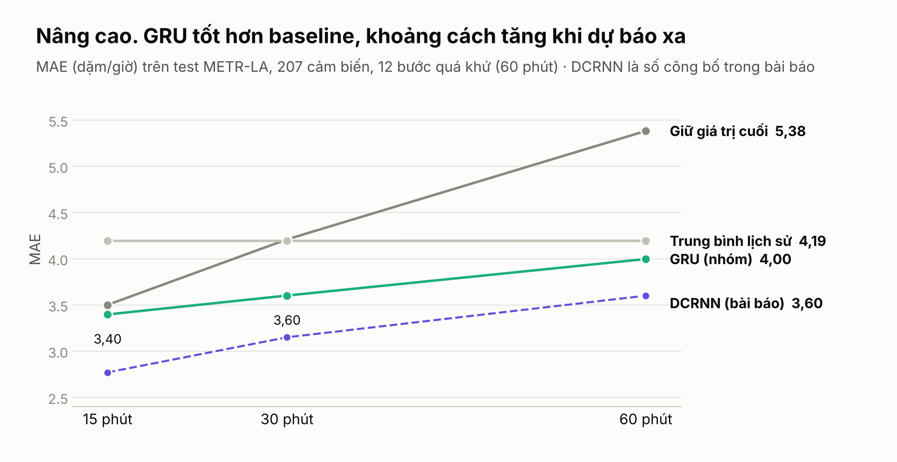

- **Dữ liệu:** **207 cảm biến** tốc độ ở Los Angeles, đo 5 phút một lần; chia train 70%, validation 10%, test 20%.
- **Bài toán:** dùng 12 bước quá khứ (60 phút) để dự báo 15, 30 và 60 phút tới.

| Mô hình | MAE 15 phút ↓ | MAE 30 phút ↓ | MAE 60 phút ↓ |
|---|---:|---:|---:|
| Giữ giá trị cuối (**mốc**) | 3,50 | 4,21 | 5,38 |
| Trung bình lịch sử | 4,19 | 4,19 | 4,19 |
| **GRU (nhóm)** | **3,40** | **3,60** | **4,00** |
| *GRU so với giữ giá trị cuối* | *↓3,0%* | *↓14,4%* | *↓25,7%* |
| DCRNN (bài báo) | 2,77 | 3,15 | 3,60 |
| *GRU so với DCRNN* | *↑22,6%* | *↑14,3%* | *↑11,0%* |

- GRU tốt hơn baseline, và khoảng cách tăng khi dự báo xa (↓3% ở 15 phút, ↓26% ở 60 phút).
- GRU vẫn kém DCRNN, vì DCRNN dùng thêm đồ thị mạng đường nối các cảm biến.

---

## 17. Kết luận

1. **Cả 3 mô hình ↓54% sai số** so với cách lấy cùng giờ hôm qua, với RMSE khoảng 6,1 MW.
2. **Cùng luật train thì ba mô hình ngang nhau** về RMSE (chênh 1,8%). Khác biệt nằm ở số tham số (420 so với 30.113), thời gian học (0,1 giây so với 145 giây), độ ổn định, khả năng giải thích, và mạnh yếu theo khung giờ, loại ngày.
3. **Kết hợp 3 mô hình cho RMSE 5,36 MW (↓12%)**, tốt nhất trong bài.

**Bài học:**
- Cách train quan trọng không kém chọn mô hình: chỉ đổi cách đưa mẫu train vào mà LSTM ↓56% sai số (13,96 → 6,14).
- So sánh mô hình phải theo cùng một luật, và nên kèm khoảng tin cậy hoặc kiểm định thống kê.

**Hướng phát triển:** thêm biến lịch và ngày lễ, dự báo nhiều bước, dùng thời tiết dự báo thay vì thời tiết đo.
