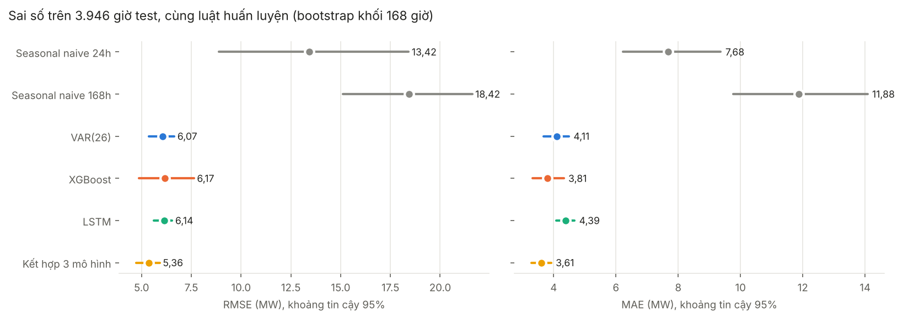
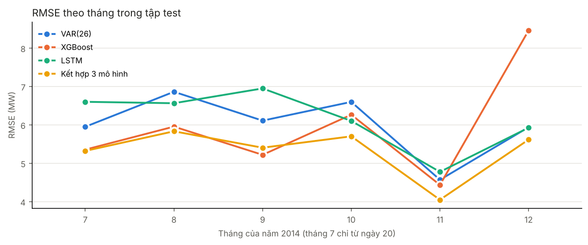

# Benchmark bổ sung: so sánh VAR, XGBoost và LSTM theo chuẩn nghiên cứu — Thành

## Tóm tắt

Trên 3.946 giờ test (20/07–31/12/2014), khi cả ba mô hình được huấn luyện theo cùng một luật, sai số của chúng gần như ngang nhau:

- RMSE: VAR(26) 6,07, XGBoost 6,17, LSTM 6,14 MW.
- Khoảng tin cậy 95% của ba mô hình chồng lên nhau.
- Kiểm định Diebold–Mariano giữa ba mô hình, sau hiệu chỉnh Holm:
  - Với sai số bình phương (ứng với RMSE), các cặp khác biệt có ý nghĩa: không cặp nào.
  - Với sai số tuyệt đối (ứng với MAE): XGBoost tốt hơn VAR(26) (p Holm = 0,01); VAR(26) tốt hơn LSTM (p Holm = 0,0016); XGBoost tốt hơn LSTM (p Holm = 0,00024).
- Cả ba đều tốt hơn rất rõ so với seasonal naive 24 giờ (RMSE 13,42 MW).
- Lấy trung bình đơn giản của ba dự báo cho RMSE 5,36 MW, thấp nhất nhưng không phải cặp nào cũng khác biệt có ý nghĩa.

## 1. Thiết kế thí nghiệm

| Hạng mục | Thiết lập |
|---|---|
| Dữ liệu | `load_weather_hourly.csv`, 26.304 giờ, 4 biến; SHA-256 `cdadc8311d55c2e9…` |
| Chia tập | Theo thời gian 70/15/15: train 18.412 giờ đến 2014-02-06 03:00:00, validation 3.946 giờ, test 3.946 giờ |
| Bài toán | Dự báo load giờ $t$ từ dữ liệu thật đến giờ $t-1$ (1 bước) |
| Luật chung | Học trên train; validation chỉ để chọn cấu hình hoặc dừng sớm; **không học lại trên test** |
| Chuẩn hóa | StandardScaler fit trên train, dùng chung cho cả ba mô hình |
| Đầu vào | 24 giờ × 4 biến (VAR dùng p = 26 theo BIC; XGBoost thêm 3 đặc trưng rolling của load) |
| Baseline | Naive (giờ trước), seasonal naive 24 giờ (cùng giờ hôm trước), seasonal naive 168 giờ (cùng giờ tuần trước) |
| Kết hợp | Trung bình đều VAR, XGBoost, LSTM; không ước lượng trọng số nên không dùng thông tin test |
| LSTM | Kiến trúc theo đề; patience 10 chọn bằng validation; mô hình chính seed 42; độ ổn định báo trên 5 seed |

Chỉ số:
- RMSE, MAE, MAPE tính trên MW.
- MASE chia MAE cho MAE trong mẫu của seasonal naive 24 giờ trên train (7,22 MW) (Hyndman & Koehler, 2006). MASE < 1 nghĩa là tốt hơn dự báo "cùng giờ hôm trước" tính trên train.
- Skill = 1 − RMSE / RMSE(seasonal naive 24h).

Suy luận thống kê:
- **Khoảng tin cậy 95%:** moving block bootstrap (Künsch, 1989), khối 168 giờ, 2000 lần lặp, cùng chỉ số khối cho mọi mô hình. Khối 1 tuần giữ được tương quan ngày và tuần của sai số.
- **Kiểm định Diebold–Mariano** (Diebold & Mariano, 1995) cho từng cặp mô hình:
  - Loss là sai số bình phương (ứng với RMSE) và sai số tuyệt đối (ứng với MAE).
  - Phương sai dài hạn Newey–West, trễ 24 giờ.
  - Hiệu chỉnh mẫu nhỏ Harvey–Leybourne–Newbold (1997), so với phân phối t.
  - Hiệu chỉnh đa so sánh Holm (1979) trên 10 cặp của mỗi loại loss.
  - Kiểm tra độ vững với trễ 168 giờ.

## 2. Kết quả chính

Giá trị là ước lượng điểm, trong ngoặc là khoảng tin cậy 95%.

| Mô hình | RMSE (MW) | MAE (MW) | MAPE (%) | MASE | Skill RMSE so với SN24 (%) |
|---|---|---|---|---|---|
| Naive (giờ trước) | 25,50 [22,82; 28,03] | 16,34 [14,74; 17,98] | 8,78 [8,34; 9,22] | 2,262 | -90,1 |
| Seasonal naive 24h | 13,42 [8,90; 18,42] | 7,68 [6,23; 9,37] | 3,82 [2,94; 5,09] | 1,063 | 0,0 |
| Seasonal naive 168h | 18,42 [15,12; 21,61] | 11,88 [9,76; 14,08] | 5,33 [4,28; 6,55] | 1,644 | -37,3 |
| VAR(26) | 6,07 [5,38; 6,65] | 4,11 [3,67; 4,49] | 2,06 [1,86; 2,31] | 0,568 | 54,8 |
| XGBoost | 6,17 [4,88; 7,64] | 3,81 [3,32; 4,32] | 1,89 [1,62; 2,28] | 0,527 | 54,0 |
| LSTM | 6,14 [5,61; 6,54] | 4,39 [4,09; 4,67] | 2,25 [2,08; 2,48] | 0,607 | 54,2 |
| Kết hợp 3 mô hình | 5,36 [4,72; 5,92] | 3,61 [3,28; 3,92] | 1,80 [1,64; 2,05] | 0,499 | 60,0 |



- **RMSE thấp nhất** trong ba mô hình là VAR(26); **MAE thấp nhất** là XGBoost.
- Khoảng tin cậy RMSE của ba mô hình chồng nhau rộng, nên không thể xếp hạng chỉ bằng ước lượng điểm.
- Seasonal naive 168 giờ (18,42 MW) kém hơn seasonal naive 24 giờ, vì vậy baseline mạnh nhất là "cùng giờ hôm trước".

## 3. Kiểm định Diebold–Mariano

DM < 0 nghĩa là A có loss trung bình nhỏ hơn B. Đơn vị chênh lệch là MW² với loss bình phương và MW với loss tuyệt đối.

**Loss bình phương (ứng với RMSE), trễ HAC 24 giờ**

| A | B | Chênh lệch loss TB (A − B) | DM | p (Holm) | Kết luận ở mức 5% |
|---|---|---|---|---|---|
| Seasonal naive 24h | VAR(26) | 143,19 | 2,83 | 0,0283 | VAR(26) tốt hơn |
| Seasonal naive 24h | XGBoost | 141,88 | 3,10 | 0,0158 | XGBoost tốt hơn |
| Seasonal naive 24h | LSTM | 142,25 | 2,76 | 0,0294 | LSTM tốt hơn |
| Seasonal naive 24h | Kết hợp 3 mô hình | 151,23 | 2,98 | 0,0203 | Kết hợp 3 mô hình tốt hơn |
| VAR(26) | XGBoost | -1,31 | -0,20 | 1 | không khác biệt có ý nghĩa |
| VAR(26) | LSTM | -0,94 | -0,54 | 1 | không khác biệt có ý nghĩa |
| VAR(26) | Kết hợp 3 mô hình | 8,04 | 9,33 | 1,67e-19 | Kết hợp 3 mô hình tốt hơn |
| XGBoost | LSTM | 0,37 | 0,05 | 1 | không khác biệt có ý nghĩa |
| XGBoost | Kết hợp 3 mô hình | 9,35 | 1,49 | 0,542 | không khác biệt có ý nghĩa |
| LSTM | Kết hợp 3 mô hình | 8,99 | 6,08 | 1,15e-08 | Kết hợp 3 mô hình tốt hơn |

**Loss tuyệt đối (ứng với MAE), trễ HAC 24 giờ**

| A | B | Chênh lệch loss TB (A − B) | DM | p (Holm) | Kết luận ở mức 5% |
|---|---|---|---|---|---|
| Seasonal naive 24h | VAR(26) | 3,57 | 6,98 | 2,07e-11 | VAR(26) tốt hơn |
| Seasonal naive 24h | XGBoost | 3,87 | 8,82 | 1,35e-17 | XGBoost tốt hơn |
| Seasonal naive 24h | LSTM | 3,29 | 6,09 | 6,08e-09 | LSTM tốt hơn |
| Seasonal naive 24h | Kết hợp 3 mô hình | 4,07 | 7,99 | 1,23e-14 | Kết hợp 3 mô hình tốt hơn |
| VAR(26) | XGBoost | 0,30 | 2,80 | 0,0103 | XGBoost tốt hơn |
| VAR(26) | LSTM | -0,28 | -3,47 | 0,00159 | VAR(26) tốt hơn |
| VAR(26) | Kết hợp 3 mô hình | 0,50 | 12,23 | 8,31e-33 | Kết hợp 3 mô hình tốt hơn |
| XGBoost | LSTM | -0,58 | -4,02 | 0,000242 | XGBoost tốt hơn |
| XGBoost | Kết hợp 3 mô hình | 0,20 | 2,14 | 0,0323 | Kết hợp 3 mô hình tốt hơn |
| LSTM | Kết hợp 3 mô hình | 0,78 | 12,32 | 3,11e-33 | Kết hợp 3 mô hình tốt hơn |

Độ vững: khi tăng trễ HAC lên 168 giờ, có **6** trên 20 kết luận chuyển thành "không khác biệt có ý nghĩa": Seasonal naive 24h – VAR(26) (loss bình phương); Seasonal naive 24h – XGBoost (loss bình phương); Seasonal naive 24h – LSTM (loss bình phương); Seasonal naive 24h – Kết hợp 3 mô hình (loss bình phương); VAR(26) – XGBoost (loss tuyệt đối); XGBoost – Kết hợp 3 mô hình (loss tuyệt đối).
Với loss bình phương, ưu thế so với seasonal naive 24 giờ không còn có ý nghĩa ở trễ 168, dù RMSE chênh hơn gấp đôi. Lý do là sai số bình phương của seasonal naive dồn vào vài tuần (49% tổng sai số bình phương nằm trong 24–31/12, chỉ 192 trên 3.946 giờ), nên phương sai dài hạn rất lớn; với loss tuyệt đối, ưu thế vẫn rõ ở cả hai mức trễ.
Các kết luận "không khác biệt" giữa VAR, XGBoost và LSTM với loss bình phương không đổi. Bảng đầy đủ ở `data/processed/benchmark/bm_dm.csv`.

## 4. Độ ổn định của LSTM theo seed

| Seed | Epoch chạy | Epoch chọn | Val RMSE | Test RMSE | Test MAE | Test MAPE (%) |
|---|---|---|---|---|---|---|
| 42 | 26 | 16 | 5,90 | 6,14 | 4,39 | 2,25 |
| 43 | 50 | 43 | 5,76 | 5,92 | 4,27 | 2,22 |
| 44 | 36 | 26 | 5,94 | 6,00 | 4,25 | 2,14 |
| 45 | 19 | 9 | 6,27 | 6,28 | 4,46 | 2,36 |
| 46 | 32 | 22 | 5,94 | 5,89 | 4,18 | 2,14 |

- Test RMSE qua 5 seed: **6,05 ± 0,16 MW**, dao động từ 5,89 đến 6,28 MW.
- RMSE của VAR(26) và XGBoost nằm trong khoảng dao động này, nên chỉ đổi seed cũng đủ làm thay đổi thứ hạng giữa LSTM và VAR(26) / XGBoost.
- VAR và XGBoost (không dùng subsample) cho cùng kết quả mỗi lần chạy.

## 5. Sai số theo nhóm (MAE, MW)

| Nhóm | Giá trị | Số giờ | Seasonal naive 24h | VAR(26) | XGBoost | LSTM | Kết hợp 3 mô hình |
|---|---|---|---|---|---|---|---|
| Khung giờ | 0–6 giờ | 1148 | 3,72 | 2,34 | 2,04 | 2,71 | 2,01 |
| Khung giờ | 7–11 giờ | 820 | 7,35 | 6,11 | 4,66 | 6,08 | 5,04 |
| Khung giờ | 12–17 giờ | 988 | 10,76 | 4,38 | 4,55 | 4,63 | 4,02 |
| Khung giờ | 18–23 giờ | 990 | 9,46 | 4,22 | 4,42 | 4,68 | 3,86 |
| Loại ngày | Ngày thường | 2640 | 6,83 | 3,94 | 3,55 | 4,14 | 3,40 |
| Loại ngày | Cuối tuần | 1066 | 6,95 | 4,13 | 3,61 | 4,69 | 3,69 |
| Loại ngày | Lễ / kỳ nghỉ cuối năm | 240 | 20,19 | 5,84 | 7,58 | 5,73 | 5,54 |

- Khung giờ có MAE cao nhất: VAR(26) 7–11 giờ; XGBoost 7–11 giờ; LSTM 7–11 giờ.
- Vào ngày lễ và kỳ nghỉ cuối năm, MAE tăng so với ngày thường ở cả ba mô hình: VAR 3,94 → 5,84, XGBoost 3,55 → 7,58, LSTM 4,14 → 5,73 MW.
- Không mô hình nào có biến lịch lễ, nên đây là điểm yếu chung.

| Tháng | Số giờ | VAR(26) | XGBoost | LSTM | Kết hợp 3 mô hình |
|---|---|---|---|---|---|
| 7 | 274 | 5,95 | 5,35 | 6,60 | 5,32 |
| 8 | 744 | 6,86 | 5,95 | 6,56 | 5,83 |
| 9 | 720 | 6,11 | 5,22 | 6,95 | 5,40 |
| 10 | 744 | 6,60 | 6,26 | 6,10 | 5,70 |
| 11 | 720 | 4,57 | 4,43 | 4,77 | 4,05 |
| 12 | 744 | 5,94 | 8,46 | 5,92 | 5,61 |



Số tháng mỗi mô hình có RMSE thấp nhất (trong ba mô hình): XGBoost 4, LSTM 2. Thứ hạng đổi theo tháng, vì vậy kết luận "mô hình nào tốt nhất" phụ thuộc vào giai đoạn đánh giá.

## 6. Chi phí tính toán

| Model | Tham số | Học (giây) | Học + dự báo 3.946 giờ (giây) | Chọn cấu hình |
|---|---|---|---|---|
| VAR(26) | 420 | 0,1 | 1,0 | p theo BIC, 1–48 trễ, trên train |
| XGBoost | 154 cây, 16.049 lá | 2,9 | 2,9 | max_depth trong {3, 5, 7, 9}, theo validation |
| LSTM | 30.113 | 145,4 | 146,1 | patience trong {5, 10} × 3 seed, theo validation |

- Thời gian đo trên cùng máy (CPU, Linux).
- Thời gian học của LSTM là trung vị của 5 seed; mỗi seed học riêng và có thể chạy song song với tác vụ khác.
- Một lần học XGBoost nhanh hơn LSTM khoảng 51 lần.

Bảng phụ, bản có học lại mỗi 168 giờ (mục 6, 7; không thuộc luật chung):

| Mô hình | RMSE | MAE | MAPE (%) | MASE |
|---|---|---|---|---|
| VAR(26), refit mỗi 168 giờ | 6,05 | 4,06 | 2,03 | 0,562 |
| XGBoost, refit mỗi 168 giờ | 6,07 | 3,71 | 1,86 | 0,514 |

## 7. Giới hạn của kết quả

1. **Một giai đoạn test duy nhất:** nửa cuối 2014, một vùng (318 khách hàng ở Bồ Đào Nha). Chưa đánh giá trên nhiều mốc gốc hay nhiều năm.
2. **Công sức tinh chỉnh không hoàn toàn bằng nhau:**
   - VAR chọn p theo BIC trên 48 giá trị.
   - XGBoost thử 4 giá trị depth.
   - LSTM thử 2 giá trị patience × 3 seed, với kiến trúc cố định theo đề.
   - Kết quả phản ánh mức tinh chỉnh vừa phải, chưa phải giới hạn tốt nhất của từng loại mô hình.
3. **Dữ liệu thời tiết:** vài giờ trống đã được nội suy từ hai phía khi tạo dữ liệu chung (mục 2), nên có rò rỉ rất nhỏ từ tương lai. Ngoài ra, thời tiết là giá trị quan trắc, không phải dự báo thời tiết.
4. **Giả định của kiểm định DM:** chuỗi chênh lệch loss dừng. Phép thử độ vững với trễ 168 giờ được dùng để kiểm tra độ nhạy của kết luận.
5. **LSTM** chỉ có 5 seed, nên độ lệch chuẩn còn thô.

## 8. Tái lập

```bash
python src/m1_var.py       # pred_var_fixed.csv
python src/m2_xgboost.py   # pred_xgb_fixed.csv
python src/m3_lstm.py      # chọn patience, pred_lstm.csv
python src/benchmark.py    # huấn luyện thêm seed 45, 46 nếu chưa có, rồi tính toàn bộ
```

Môi trường: Python 3.13.18, numpy 2.5.3, pandas 3.0.5, statsmodels 0.15.0, xgboost 3.4.1, TensorFlow 2.20.0. Bootstrap và mọi mô hình dùng seed 42. Chi tiết ở `data/processed/benchmark/bm_environment.json`.

## Tài liệu tham khảo

- Diebold, F. X., & Mariano, R. S. (1995). Comparing predictive accuracy. *Journal of Business & Economic Statistics*, 13(3), 253–263.
- Harvey, D., Leybourne, S., & Newbold, P. (1997). Testing the equality of prediction mean squared errors. *International Journal of Forecasting*, 13(2), 281–291.
- Holm, S. (1979). A simple sequentially rejective multiple test procedure. *Scandinavian Journal of Statistics*, 6(2), 65–70.
- Hyndman, R. J., & Koehler, A. B. (2006). Another look at measures of forecast accuracy. *International Journal of Forecasting*, 22(4), 679–688.
- Künsch, H. R. (1989). The jackknife and the bootstrap for general stationary observations. *The Annals of Statistics*, 17(3), 1217–1241.
- Newey, W. K., & West, K. D. (1987). A simple, positive semi-definite, heteroskedasticity and autocorrelation consistent covariance matrix. *Econometrica*, 55(3), 703–708.
