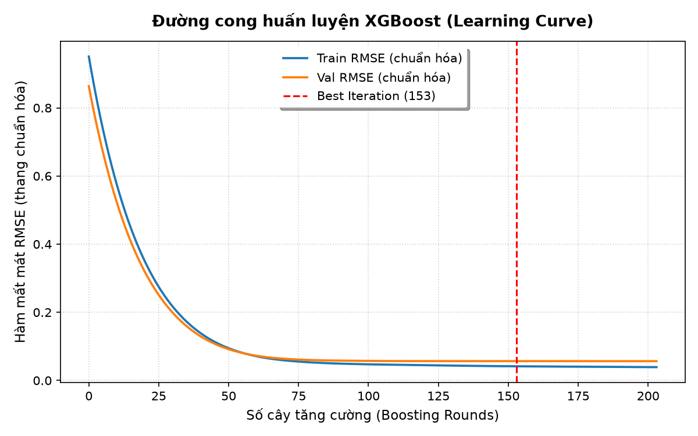
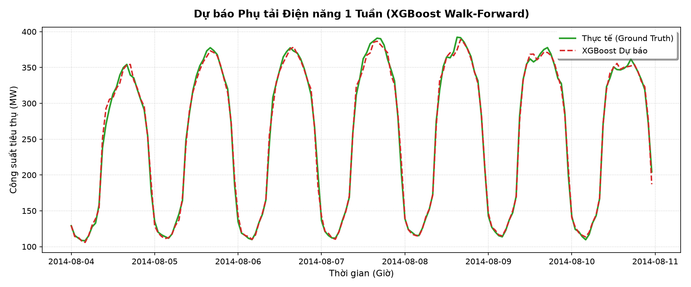

# Mục 7: Mô hình XGBoost (Hoàng Thắng)

## 7.1. Thiết lập bài toán và cấu trúc đặc trưng

Khác với mô hình VAR hay LSTM tiếp nhận dữ liệu chuỗi trực tiếp, XGBoost là mô hình học máy dạng cây quyết định tăng cường gradient (Gradient Boosted Trees), yêu cầu đầu vào là vector đặc trưng dạng phẳng (tabular format).

Tại mỗi thời điểm $t$, mô hình sử dụng **99 đặc trưng** để dự báo phụ tải điện năng tại thời điểm kế tiếp $\text{load}_{t+1}$:
1. **96 đặc trưng trễ (Lag features):** Trích xuất cửa sổ $L = 24$ giờ quá khứ ($t-23, \dots, t$) cho cả 4 biến:
   - Phụ tải: $\text{load\_lag1}, \dots, \text{load\_lag24}$
   - Nhiệt độ: $\text{temperature\_lag1}, \dots, \text{temperature\_lag24}$
   - Độ ẩm: $\text{humidity\_lag1}, \dots, \text{humidity\_lag24}$
   - Tốc độ gió: $\text{wind\_speed\_lag1}, \dots, \text{wind\_speed\_lag24}$
2. **3 đặc trưng thống kê cuộn (Rolling features):** Được tính toán lũy tích đến thời điểm $t$ từ chuỗi phụ tải (đảm bảo không rò rỉ thông tin tương lai):
   - `load_roll_mean_6`: Trung bình phụ tải 6 giờ gần nhất (nắm bắt mức tải ngắn hạn).
   - `load_roll_std_24`: Độ lệch chuẩn phụ tải 24 giờ qua (đo lường độ biến động trong ngày).
   - `load_trend_24`: Xu hướng phụ tải $\text{load}_t - \text{load}_{t-24}$ (so sánh trực tiếp với cùng thời điểm hôm trước).

Dữ liệu được chia theo thời gian đúng quy ước chung:
- **Train (70%):** 18.388 mẫu (02/01/2012 00:00 đến 06/02/2014 03:00)
- **Validation (15%):** 3.946 mẫu (06/02/2014 04:00 đến 20/07/2014 13:00)
- **Test (15%):** 3.946 mẫu (20/07/2014 14:00 đến 31/12/2014 23:00)

---

## 7.2. Tinh chỉnh siêu tham số (Hyperparameter Tuning)

Tiến hành khảo sát độ sâu tối đa của cây $\text{max\_depth} \in \{3, 5, 7, 9\}$ với các tham số cố định:
- `learning_rate` = 0.05 (tốc độ học vừa phải, tránh nhảy bước quá lớn)
- `n_estimators` = 2000 kết hợp `early_stopping_rounds` = 50 (dừng khi hàm mất mát RMSE trên tập validation không giảm trong 50 vòng lặp liên tiếp)
- `eval_metric` = "rmse"
- `random_state` = 42

Kết quả đánh giá trên tập Validation (sau khi chuyển ngược về thang đo thực MW):

| max_depth | Best Iteration | Val RMSE (MW) | Val MAE (MW) | Val MAPE (%) | Đánh giá |
|:---:|:---:|:---:|:---:|:---:|:---|
| 3 | 664 | 4,69 | 3,27 | 1,75 | Cây nông, cần nhiều cây hơn, chưa bắt hết tương tác phi tuyến |
| 5 | 263 | 4,55 | 3,15 | 1,67 | Hiệu năng tốt, tốc độ hội tụ nhanh |
| **7** | **153** | **4,52** | **3,12** | **1,65** | **Tốt nhất trên mọi chỉ số, số cây tối ưu nhỏ gọn** |
| 9 | 275 | 4,65 | 3,18 | 1,67 | Bắt đầu có dấu hiệu quá khớp (overfitting) do cây quá sâu |

=> **Mô hình được lựa chọn:** `max_depth = 7`, `best_iteration = 153`.

**Hình 7.1.** Đường cong huấn luyện (Learning Curve) của mô hình XGBoost với `max_depth=7`. Hàm mất mát trên tập Train giảm đều đặn trong khi Validation đạt điểm cực tiểu tại vòng lặp 153 và kích hoạt cơ chế Early Stopping, ngăn ngừa hoàn toàn hiện tượng quá khớp.

---

## 7.3. Đánh giá Walk-Forward trên tập Test

Áp dụng phương pháp kiểm định tiến dần **Walk-Forward Validation** (rolling-origin) trên toàn bộ 3.946 giờ của tập Test (20/07/2014 14:00 đến 31/12/2014 23:00):
- Tại mỗi mốc $t$, mô hình nhận vector đặc trưng được tạo từ dữ liệu quan sát thực tế đến thời điểm $t$ để dự báo $\text{load}_{t+1}$.
- Cứ sau mỗi 168 giờ (1 tuần), mô hình được tái huấn luyện (refit) trên toàn bộ lịch sử tích lũy từ đầu đến thời điểm đó với `n_estimators = 153`.

Kết quả định lượng trên tập Test (thang đo công suất gốc MW):

| Chỉ số | Giá trị | Ý nghĩa thực tế |
|---|:---:|---|
| **RMSE** | **6,07 MW** | Độ lệch quân phương chỉ chiếm **2,98%** so với phụ tải trung bình (203,3 MW) |
| **MAE** | **3,71 MW** | Sai số tuyệt đối trung bình mỗi giờ dưới 3,8 MW |
| **MAPE** | **1,86 %** | Tỷ lệ sai số phần trăm tuyệt đối trung bình rất thấp (< 2%) |
| **Thời gian chạy** | **75,2 giây** | Huấn luyện và cập nhật 24 lần trên 3.946 giờ kiểm thử rất nhanh |

**Hình 7.2.** So sánh phụ tải thực tế và dự báo của XGBoost trong 1 tuần cao điểm mùa hè (04/08/2014 – 10/08/2014).

### Nhận xét:
1. Đường dự báo của XGBoost bám cực kỳ sát đường thực tế ở cả các đỉnh phụ tải ban ngày (đạt trên 320 MW) lẫn đáy phụ tải ban đêm (dưới 110 MW).
2. Mô hình phản ứng nhạy bén với sự chuyển dịch tải giữa các ngày trong tuần và hai ngày cuối tuần (thứ Bảy và Chủ nhật phụ tải hạ thấp rõ rệt).
3. Sai số Walk-forward với việc refit định kỳ 1 tuần/lần giúp mô hình nhanh chóng thích nghi khi thời tiết chuyển mùa từ thu sang đông vào cuối năm 2014.

## 7.4. Bản dùng cho so sánh công bằng (mục 10)

Để so với VAR và LSTM theo cùng một luật, giữ nguyên mô hình đã chọn ở 7.2 (max_depth = 7, học trên train, early stopping theo validation, 153 cây) và **không refit** trên test. Mỗi giờ test vẫn dùng lag thật tới giờ $t$. Kết quả lưu ở `data/processed/pred_xgb_fixed.csv`:

| Cách đánh giá | RMSE (MW) | MAE (MW) | MAPE (%) |
|---|:---:|:---:|:---:|
| Walk-forward, refit mỗi 168 giờ (7.3) | 6,07 | 3,71 | 1,86 |
| Học một lần trên train, không refit | 6,17 | 3,81 | 1,89 |

Refit hằng tuần giúp giảm RMSE khoảng 0,10 MW (1,6%). Mức này nhỏ so với khác biệt giữa các mô hình, nên bảng so sánh chính ở mục 10 dùng bản không refit cho cả ba mô hình.
