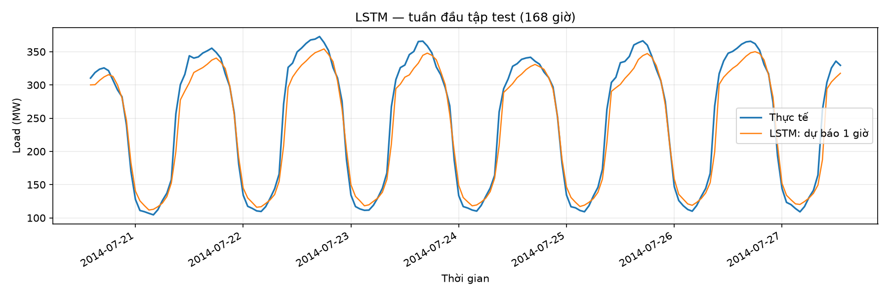

# Mục 8. Mô hình LSTM — Hoàng Nam

## Bài toán và dữ liệu

Dùng 24 giờ quan sát gần nhất của 4 biến `load`, `temperature`, `humidity`, `wind_speed` để dự báo load giờ tiếp theo. Dữ liệu chung có 26,304 giờ. StandardScaler chỉ fit trên train. Mỗi cửa sổ được xếp vào tập theo thời điểm của y, nên đầu validation/test được dùng lịch sử trước ranh giới.

| Tập | samples | start | end |
| --- | --- | --- | --- |
| train | 18388 | 2012-01-02 00:00:00 | 2014-02-06 03:00:00 |
| validation | 3946 | 2014-02-06 04:00:00 | 2014-07-20 13:00:00 |
| test | 3946 | 2014-07-20 14:00:00 | 2014-12-31 23:00:00 |

## Kiến trúc và huấn luyện

`Input(24,4) → LSTM(64, return_sequences=True) → LSTM(32) → Dense(1)`.

- Số tham số: **30,113**.
- Loss MSE trên dữ liệu chuẩn hóa; Adam learning rate 0,001; seed 42.
- Tối đa 50 epoch, batch 64; giữ nguyên thứ tự mẫu; validation theo thời gian.
- EarlyStopping theo `val_loss`, patience 5, khôi phục trọng số tốt nhất.
- Thực chạy **21 epoch**, chọn epoch **16**; thời gian `fit`: **164.329 giây**, thiết bị /physical_device:CPU:0. Thời gian không gồm đọc dữ liệu, dự báo, xuất hình.
- Python 3.12.14, TensorFlow 2.20.0, numpy 2.3.5, pandas 3.0.1.

## Backtesting và kết quả

Walk-forward một bước với trọng số cố định: tại mỗi giờ test, đầu vào là 24 giờ **giá trị thật quá khứ**. Không refit trên test. Dự báo các cửa sổ theo batch cho cùng phép đánh giá vì trọng số cố định. Đây không phải dự báo đệ quy nhiều ngày từ một mốc duy nhất.

Đã đảo chuẩn hóa về MW trước khi tính chỉ số bằng `utils.metrics()`:

| Tập | RMSE | MAE | MAPE(%) |
| --- | --- | --- | --- |
| train | 12.02 | 8.22 | 4.11 |
| validation | 9.76 | 6.65 | 3.48 |
| test | 13.96 | 9.57 | 4.75 |

So với hai baseline trên đúng cùng các giờ test:

| Model | RMSE | MAE | MAPE(%) |
| --- | --- | --- | --- |
| Naive | 25.5 | 16.34 | 8.78 |
| Seasonal naive (24h) | 13.42 | 7.68 | 3.82 |
| LSTM (L=24) | 13.96 | 9.57 | 4.75 |

RMSE LSTM **cao hơn seasonal naive 24 giờ 4.02%**
(13.96 so với 13.42 MW). Kết quả này cho thấy cần giữ baseline
đơn giản trong bảng đánh giá; kiến trúc phức tạp hơn không tự bảo đảm sai số thấp hơn.
Không thay đổi checkpoint hoặc cấu hình dựa trên kết quả test này.

Đầu ra: `data/processed/pred_lstm.csv`, 3946 dòng, ba cột `Datetime,y_true,y_pred`. Số liệu sinh từ mô hình huấn luyện trên dữ liệu thật.

## Giới hạn

Một lần chạy seed 42 chưa cho biết độ ổn định qua nhiều seed. Chọn checkpoint theo validation; test chỉ dùng báo cáo. Dữ liệu chung đã được nhóm nội suy/điền thiếu từ trước, có phương pháp dùng quan sát tương lai; thí nghiệm này không chứng minh toàn bộ quy trình dữ liệu thô vận hành trực tuyến. Kết quả áp dụng cho tập test và cách tạo dữ liệu đã nêu.
