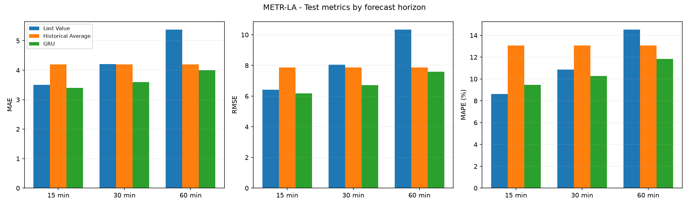
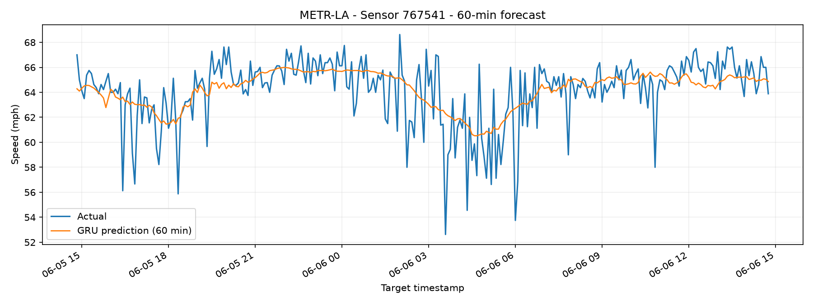

# 12. Nâng cao: Dự báo tốc độ giao thông trên METR-LA

## 12.1. Dữ liệu và bài toán

Phần nâng cao sử dụng bộ dữ liệu METR-LA, gồm tốc độ giao thông được ghi nhận tại 207 cảm biến trên hệ thống đường cao tốc ở Los Angeles. Dữ liệu có 34.272 mốc thời gian, với tần suất lấy mẫu 5 phút/lần. Mỗi mốc chứa tốc độ đo được tại 207 cảm biến, đơn vị mph.

Mục tiêu là sử dụng dữ liệu tốc độ của 12 bước thời gian gần nhất (60 phút) để dự báo tốc độ tại tất cả cảm biến ở ba mốc tương lai: 15 phút, 30 phút và 60 phút.

Dữ liệu được chia theo thứ tự thời gian, không xáo trộn, với tỷ lệ 70% huấn luyện, 10% validation và 20% kiểm tra. Cụ thể:

| Tập dữ liệu | Số mốc thời gian | Tỷ lệ |
|---|---:|---:|
| Train | 23.990 | 70% |
| Validation | 3.427 | 10% |
| Test | 6.855 | 20% |

Trong METR-LA, giá trị tốc độ bằng 0 được xem là dữ liệu cảm biến không hợp lệ. Các giá trị này không được tính vào chỉ số đánh giá. Để tạo đầu vào liên tục cho mô hình, dữ liệu thiếu được điền theo những quan sát hợp lệ trước đó, đồng thời sử dụng thống kê tập Train cho các vị trí chưa có giá trị trước đó. Việc chuẩn hóa cũng chỉ dựa trên tập Train nhằm hạn chế rò rỉ thông tin.

## 12.2. Các mô hình thực nghiệm

Nhóm thực hiện so sánh ba phương pháp dự báo:

- **Last Value:** sử dụng tốc độ quan sát hợp lệ gần nhất làm giá trị dự báo cho các mốc tương lai.
- **Historical Average:** dự báo bằng tốc độ trung bình lịch sử của từng cảm biến tại cùng thời điểm trong tuần, được tính từ tập Train.
- **GRU (Gated Recurrent Unit):** mô hình học sâu xử lý chuỗi tốc độ 12 bước quá khứ và dự báo đồng thời 207 cảm biến tại ba khoảng thời gian.

Mô hình GRU sử dụng hidden size 128, batch size 64, learning rate 0,001 và tối đa 20 epoch. Quá trình huấn luyện có Early Stopping với patience bằng 5 nhằm hạn chế overfitting.

Mô hình đạt Validation Loss tốt nhất khoảng 0,2561 tại epoch 13. Sau 5 epoch tiếp theo không cải thiện, quá trình huấn luyện dừng ở epoch 18. Trọng số tại epoch tốt nhất được lưu để đánh giá trên tập Test.

## 12.3. Kết quả đánh giá trên tập Test

Các mô hình được đánh giá bằng MAE, RMSE và MAPE. Chỉ số được tính trên tốc độ gốc (mph), bỏ qua các vị trí có giá trị thực tế bằng 0 hoặc không hợp lệ. MAE và RMSE càng thấp thể hiện sai số dự báo càng nhỏ.

**Bảng 12.1. Kết quả dự báo trên tập Test của METR-LA**

| Mô hình | Tầm dự báo | MAE | RMSE | MAPE (%) |
|---|---|---:|---:|---:|
| Last Value | 15 phút | 3,5011 | 6,4227 | 8,6202 |
| Last Value | 30 phút | 4,2095 | 8,0578 | 10,8697 |
| Last Value | 60 phút | 5,3827 | 10,3484 | 14,5406 |
| Historical Average | 15 phút | 4,1928 | 7,8617 | 13,0614 |
| Historical Average | 30 phút | 4,1929 | 7,8618 | 13,0617 |
| Historical Average | 60 phút | 4,1934 | 7,8620 | 13,0616 |
| **GRU** | **15 phút** | **3,3970** | **6,1699** | **9,4553** |
| **GRU** | **30 phút** | **3,6015** | **6,7160** | **10,2635** |
| **GRU** | **60 phút** | **3,9969** | **7,5864** | **11,8432** |

*Hình 12.1. So sánh MAE, RMSE và MAPE của ba mô hình tại các mốc dự báo 15, 30 và 60 phút.*

Kết quả cho thấy GRU đạt MAE và RMSE thấp nhất ở cả ba tầm dự báo. So với Last Value, MAE của GRU giảm khoảng 3,0% ở mốc 15 phút, 14,4% ở mốc 30 phút và 25,7% ở mốc 60 phút. Điều này cho thấy lợi thế của GRU rõ rệt hơn khi khoảng thời gian dự báo tăng.

Last Value hoạt động tương đối tốt ở mốc 15 phút vì tốc độ giao thông trong khoảng thời gian ngắn thường chưa thay đổi quá nhiều. Tuy nhiên, sai số tăng nhanh khi dự báo xa hơn. Trong khi đó, Historical Average có sai số gần như ổn định giữa các mốc vì phương pháp này chủ yếu phản ánh quy luật tốc độ trung bình theo thời điểm trong tuần.

Riêng chỉ số MAPE tại mốc 15 phút, Last Value đạt 8,6202%, thấp hơn GRU (9,4553%). Vì vậy, GRU không vượt trội ở mọi chỉ số, dù đạt kết quả tốt nhất về MAE và RMSE.

## 12.4. Phân tích dự báo tại một cảm biến

Để quan sát trực tiếp khả năng dự báo, nhóm lựa chọn cảm biến 767541 và biểu diễn tốc độ thực tế cùng dự báo GRU ở tầm 60 phút.

*Hình 12.2. So sánh tốc độ thực tế và dự báo trước 60 phút của GRU tại cảm biến 767541.*

Đường dự báo GRU nhìn chung bám theo xu hướng tăng giảm của tốc độ thực tế. Mô hình thể hiện được những giai đoạn tốc độ giảm rồi phục hồi, cho thấy khả năng khai thác thông tin từ chuỗi quan sát trước đó.

Tuy nhiên, đường dự báo mượt hơn đáng kể so với đường thực tế. Tại một số thời điểm tốc độ giảm đột ngột, GRU chưa dự báo được đầy đủ biên độ biến động. Chẳng hạn, trong khoảng rạng sáng ngày 06/06, tốc độ thực tế có thời điểm giảm xuống gần 53 mph, trong khi dự báo vẫn ở mức cao hơn.

Kết quả này cho thấy mô hình học được xu hướng chung nhưng còn hạn chế trước các biến động bất thường. Đây cũng là một khó khăn của bài toán dự báo giao thông ở khoảng thời gian xa.

## 12.5. Đối chiếu với mô hình DCRNN

Nghiên cứu *Diffusion Convolutional Recurrent Neural Network: Data-Driven Traffic Forecasting* đề xuất mô hình DCRNN, kết hợp mạng hồi tiếp với phép tích chập khuếch tán trên đồ thị giao thông. Khác với GRU trong thực nghiệm này, DCRNN khai thác thêm quan hệ không gian giữa các cảm biến thông qua cấu trúc mạng đường bộ.

Các kết quả MAE được công bố cho DCRNN trên METR-LA lần lượt khoảng 2,77; 3,15 và 3,60 tại các tầm dự báo 15, 30 và 60 phút. Trong khi đó, GRU của nhóm đạt 3,3970; 3,6015 và 3,9969.

| Tầm dự báo | GRU của nhóm (MAE) | DCRNN trong nghiên cứu (MAE) |
|---|---:|---:|
| 15 phút | 3,3970 | 2,77 |
| 30 phút | 3,6015 | 3,15 |
| 60 phút | 3,9969 | 3,60 |

DCRNN có MAE được công bố thấp hơn GRU của nhóm ở cả ba tầm dự báo. Một nguyên nhân hợp lý là DCRNN mô hình hóa được sự lan truyền của tình trạng giao thông giữa các cảm biến có kết nối, trong khi GRU của nhóm chủ yếu học quan hệ theo thời gian từ dữ liệu tốc độ.

Tuy nhiên, đây là so sánh tham khảo với kết quả đã công bố, không phải thực nghiệm tái lập DCRNN trong cùng môi trường. Những khác biệt về tiền xử lý, cách tạo mẫu và giao thức đánh giá có thể ảnh hưởng đến sai số.

Nguồn tham khảo: Li và cộng sự, *Diffusion Convolutional Recurrent Neural Network: Data-Driven Traffic Forecasting* (ICLR 2018).

- Paper: https://arxiv.org/abs/1707.01926
- Mã nguồn: https://github.com/liyaguang/DCRNN

## 12.6. Nhận xét và kết luận

Thực nghiệm trên METR-LA cho thấy GRU cải thiện sai số dự báo so với hai phương pháp cơ sở, đặc biệt tại mốc 60 phút. Mô hình đạt MAE 3,9969 và RMSE 7,5864 ở tầm dự báo xa nhất, đồng thời có khả năng theo dõi xu hướng biến động tốc độ giao thông.

Dù vậy, GRU vẫn gặp khó khăn khi tốc độ thay đổi đột ngột và chưa khai thác trực tiếp cấu trúc kết nối giữa các cảm biến. Kết quả đối chiếu với DCRNN gợi ý rằng việc bổ sung thông tin không gian có thể giúp cải thiện chất lượng dự báo trong các nghiên cứu tiếp theo.