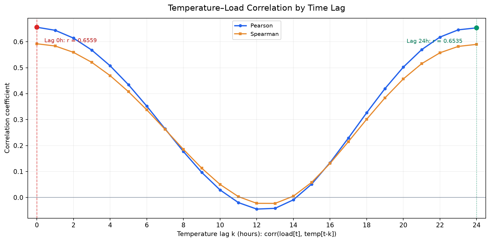

# Câu 1 – Biến thời tiết nào ảnh hưởng mạnh nhất đến phụ tải điện?

## 1. Mục tiêu và dữ liệu phân tích

Câu hỏi đặt ra là trong ba yếu tố thời tiết gồm nhiệt độ, độ ẩm và tốc độ gió, yếu tố nào có mối liên hệ mạnh nhất với phụ tải điện. Để trả lời, nhóm sử dụng hệ số tương quan Pearson và Spearman, kết hợp phân tích theo mùa, độ trễ thời gian và điều chỉnh chu kỳ giờ trong ngày.

Dữ liệu gồm **26.304 quan sát theo giờ**, từ ngày 01/01/2012 đến 31/12/2014, với bốn biến chính: phụ tải (`load`), nhiệt độ (`temperature`), độ ẩm (`humidity`) và tốc độ gió (`wind_speed`). Dữ liệu được lấy từ tập đã xử lý ở Mục 2.

Trong phạm vi Câu 1, khái niệm "ảnh hưởng mạnh nhất" được đánh giá thông qua **mức độ tương quan thống kê**, không đồng nghĩa với việc xác định quan hệ nhân quả.

## 2. Kết quả và phân tích

### 2.1. Mức độ tương quan giữa các biến thời tiết và phụ tải

| Biến thời tiết | Pearson | Spearman | \|Pearson\| |
|---|---:|---:|---:|
| Nhiệt độ (`temperature`) | 0.6559 | 0.5922 | 0.6559 |
| Độ ẩm (`humidity`) | -0.5277 | -0.4922 | 0.5277 |
| Tốc độ gió (`wind_speed`) | 0.2803 | 0.3002 | 0.2803 |

**Nhiệt độ là biến có tương quan mạnh nhất với phụ tải điện.** Pearson đạt 0.6559, cho thấy phụ tải và nhiệt độ có xu hướng biến động cùng chiều khá rõ trong tập dữ liệu. Spearman đạt 0.5922, củng cố nhận xét rằng giữa hai biến tồn tại mối liên hệ cùng chiều, dù không nhất thiết hoàn toàn tuyến tính.

Độ ẩm có Pearson bằng -0.5277 và Spearman bằng -0.4922. Dấu âm cho thấy khi độ ẩm tăng, phụ tải có xu hướng giảm trong dữ liệu quan sát. Tuy nhiên, không thể từ kết quả này kết luận độ ẩm trực tiếp làm giảm nhu cầu điện, bởi độ ẩm có thể biến động đồng thời với nhiệt độ và các điều kiện thời tiết khác.

Tốc độ gió có tương quan dương yếu hơn, với Pearson bằng 0.2803 và Spearman bằng 0.3002. Điều này cho thấy tốc độ gió có mối liên hệ với phụ tải, nhưng xét riêng từng biến thì mức độ tương quan thấp hơn đáng kể so với nhiệt độ và độ ẩm.

Thứ tự theo giá trị tuyệt đối Pearson là:

**Nhiệt độ (0.6559) > Độ ẩm (0.5277) > Tốc độ gió (0.2803).**

Thứ tự này không thay đổi khi sử dụng Spearman. Việc hai phương pháp cho cùng thứ hạng giúp kết luận về biến thời tiết nổi bật nhất có cơ sở vững hơn so với chỉ dựa vào một hệ số tương quan.

### 2.2. Mối quan hệ giữa nhiệt độ và phụ tải theo mùa

| Mùa | Số quan sát | Nhiệt độ | Độ ẩm | Tốc độ gió |
|---|---:|---:|---:|---:|
| Đông | 6,504 | 0.4337 | -0.3060 | 0.1532 |
| Xuân | 6,624 | 0.6653 | -0.5134 | 0.3028 |
| Hè | 6,624 | 0.7203 | -0.6263 | 0.3268 |
| Thu | 6,552 | 0.6154 | -0.4500 | 0.2958 |

*Bảng thể hiện hệ số tương quan Pearson trong từng mùa khí tượng.*

Tương quan giữa nhiệt độ và phụ tải thay đổi đáng kể theo mùa. Mùa hè có hệ số cao nhất (**0.7203**), tiếp theo là mùa xuân (**0.6653**), mùa thu (**0.6154**) và mùa đông (**0.4337**).

Kết quả này cho thấy mối liên hệ giữa nhiệt độ và phụ tải rõ rệt hơn trong những tháng mùa hè. Một cách giải thích có thể là nhu cầu sử dụng thiết bị làm mát tăng khi thời tiết nóng, nhưng dữ liệu hiện tại không có thông tin về hành vi sử dụng điện để kiểm chứng trực tiếp giả thuyết đó.

Đáng chú ý, nhiệt độ vẫn có tương quan dương trong cả bốn mùa. Vì vậy, từ bảng tương quan theo mùa chưa quan sát được sự đảo chiều rõ ràng giữa mùa lạnh và mùa nóng như có thể kỳ vọng ở một quan hệ hình chữ U.

Để kiểm tra thêm, nhóm xét đại lượng độ lệch nhiệt độ tuyệt đối so với 18°C:

`temperature_deviation = |temperature - 18|`

Kết quả tương quan với phụ tải:

| Phương pháp | Hệ số |
|---|---:|
| Pearson | 0.1008 |
| Spearman | -0.0057 |

Pearson chỉ đạt 0.1008, còn Spearman gần bằng 0. Điều này cho thấy khoảng cách nhiệt độ so với mốc 18°C chưa thể hiện mối liên hệ rõ rệt với phụ tải trên toàn bộ tập dữ liệu.

Do đó, **chưa có đủ bằng chứng từ phép kiểm tra này để khẳng định quan hệ nhiệt độ – phụ tải có dạng chữ U**. Mốc 18°C được sử dụng như một phép biến đổi để khảo sát, không phải nhiệt độ cân bằng tối ưu đã được ước lượng từ dữ liệu.

### 2.3. Phân tích tương quan theo độ trễ 0–24 giờ

Ngoài tương quan tại cùng thời điểm, nhóm kiểm tra xem nhiệt độ trong những giờ trước có liên hệ như thế nào với phụ tải hiện tại. Với độ trễ `k`, hệ số được tính giữa `load(t)` và `temperature(t-k)`.

**Hình 1.** Tương quan Pearson và Spearman giữa phụ tải hiện tại và nhiệt độ tại các độ trễ từ 0 đến 24 giờ.

| Độ trễ | Pearson | Spearman |
|---|---:|---:|
| 0 giờ | 0.6559 | 0.5922 |
| 6 giờ | 0.3519 | 0.3376 |
| 12 giờ | -0.0447 | -0.0225 |
| 18 giờ | 0.3263 | 0.3014 |
| 24 giờ | 0.6535 | 0.5899 |

Biểu đồ cho thấy tương quan không giảm liên tục khi tăng độ trễ mà có xu hướng giảm rồi tăng trở lại.

**Tại lag 0**, Pearson đạt 0.6559, là giá trị tuyệt đối lớn nhất trong 25 độ trễ được khảo sát. Như vậy, khi xét riêng tương quan tuyến tính, nhiệt độ cùng giờ có mối liên hệ mạnh nhất với phụ tải hiện tại.

**Tại lag 12**, Pearson giảm xuống -0.0447, gần bằng 0. Điều này cho thấy nhiệt độ của 12 giờ trước hầu như không có tương quan tuyến tính với phụ tải hiện tại khi xét trên toàn bộ dữ liệu. Giá trị gần 0 không có nghĩa hai đại lượng hoàn toàn độc lập hoặc không tồn tại quan hệ phi tuyến.

**Tại lag 24**, Pearson tăng trở lại 0.6535, chỉ thấp hơn lag 0 khoảng 0.0024. Đây là điểm đáng chú ý vì 24 giờ tương ứng với một chu kỳ ngày. Kết quả phù hợp với đặc điểm lặp lại theo giờ của nhiệt độ và phụ tải, đồng thời nhất quán với dấu hiệu chu kỳ ngày đã được nhận diện ở phần EDA.

Hai đường Pearson và Spearman có hình dạng tương tự nhau, cho thấy xu hướng biến đổi theo độ trễ không chỉ xuất hiện khi sử dụng Pearson.

Tuy nhiên, tương quan cao tại lag 24 có thể xuất phát từ chu kỳ thời gian chung của hai chuỗi. Vì vậy, **không thể xem lag 24 là bằng chứng về tác động nhân quả trễ một ngày của nhiệt độ lên phụ tải**.

### 2.4. Kiểm tra tương quan sau khi loại bỏ chu kỳ giờ trong ngày

Phụ tải và nhiệt độ đều có thể biến đổi theo giờ trong ngày. Nếu hai chuỗi cùng tăng hoặc giảm ở những khung giờ tương tự, hệ số tương quan ban đầu có thể phản ánh một phần đặc điểm chu kỳ chung.

Để kiểm tra, nhóm trừ khỏi mỗi quan sát giá trị trung bình của biến tại cùng giờ trong ngày, tạo thành hai chuỗi phần dư. Sau đó tính lại Pearson và Spearman giữa hai chuỗi này.

| Phương pháp | Dữ liệu ban đầu | Sau điều chỉnh |
|---|---:|---:|
| Pearson | 0.6559 | 0.7572 |
| Spearman | 0.5922 | 0.7885 |

Sau khi loại bỏ thành phần trung bình theo giờ, Pearson tăng **0.1013** và Spearman tăng **0.1963**.

Điều này cho thấy mối tương quan giữa nhiệt độ và phụ tải không biến mất khi loại bỏ chu kỳ giờ trung bình. Ngược lại, trong dữ liệu đã điều chỉnh, các biến động quanh mức trung bình theo giờ có mối liên hệ cùng chiều rõ hơn.

Kết quả cũng cho thấy không nên giải thích toàn bộ tương quan ban đầu chỉ bằng việc nhiệt độ và phụ tải cùng có chu kỳ ngày. Tuy vậy, phép điều chỉnh chưa kiểm soát các yếu tố khác như mùa, ngày trong tuần hoặc xu hướng dài hạn, nên chưa đủ để xác định tác động độc lập của nhiệt độ.

## 3. Kết luận – Trả lời Câu 1

1. **Nhiệt độ là biến thời tiết có tương quan mạnh nhất với phụ tải điện** trong ba biến khảo sát, với Pearson 0.6559 và Spearman 0.5922.
2. Độ ẩm đứng thứ hai về độ lớn tương quan (Pearson -0.5277), còn tốc độ gió có tương quan yếu nhất (Pearson 0.2803).
3. Tương quan nhiệt độ – phụ tải mạnh nhất vào mùa hè (0.7203) và thấp nhất vào mùa đông (0.4337), cho thấy mối liên hệ thay đổi theo mùa.
4. Phép kiểm tra `|temperature - 18|` chưa cung cấp bằng chứng rõ ràng cho quan hệ hình chữ U.
5. Tương quan theo độ trễ mạnh nhất tại lag 0 (0.6559); lag 24 gần tương đương (0.6535), phù hợp với tính chu kỳ ngày.
6. Sau khi loại bỏ thành phần trung bình theo giờ, Pearson tăng lên 0.7572 và Spearman tăng lên 0.7885, cho thấy mối liên hệ vẫn tồn tại rõ rệt.
7. Kết luận được giới hạn ở **tương quan thống kê**, không khẳng định nhiệt độ là nguyên nhân trực tiếp tạo ra thay đổi phụ tải hoặc là biến quan trọng nhất trong mọi mô hình dự báo.

## 4. Đối chiếu với kết quả Câu 3 – Feature Importance của XGBoost

### 4.1. So sánh thứ hạng các biến thời tiết

Câu 1 sử dụng Pearson và Spearman để đánh giá mối liên hệ giữa từng biến thời tiết với phụ tải. Trong Câu 3, Hoàng Thắng sử dụng Feature Importance theo Gain của XGBoost để xác định mức độ quan trọng của các nhóm đặc trưng khi dự báo phụ tải.

| Biến thời tiết | Pearson (Câu 1) | Spearman (Câu 1) | Tỷ lệ Gain (Câu 3) |
|---|---:|---:|---:|
| Nhiệt độ | 0.6559 | 0.5922 | 0.94% |
| Độ ẩm | -0.5277 | -0.4922 | 0.47% |
| Tốc độ gió | 0.2803 | 0.3002 | 0.39% |

Hai phương pháp cho cùng thứ hạng khi xét độ lớn tuyệt đối của tương quan và tỷ lệ Gain: **nhiệt độ > độ ẩm > tốc độ gió**.

Ở Câu 1, nhiệt độ có tương quan mạnh nhất với phụ tải. Trong Câu 3, nhóm 24 đặc trưng nhiệt độ trễ có tổng Gain là 1.37, tương ứng 0.94% tổng Gain, cao hơn nhóm độ ẩm (0.47%) và tốc độ gió (0.39%). Kết quả này nhất quán với kết luận ban đầu rằng nhiệt độ là biến nổi bật nhất trong ba yếu tố thời tiết.

Tuy nhiên, Pearson và Spearman đo mối liên hệ thống kê giữa từng biến với phụ tải, còn Gain phản ánh mức độ quan trọng của đặc trưng trong các phép phân nhánh của mô hình. Vì vậy, chỉ có thể đối chiếu về thứ hạng, không so sánh trực tiếp giá trị hệ số tương quan với phần trăm Gain.

### 4.2. Vai trò của độ trễ và chu kỳ ngày

Trong Câu 1, tương quan Pearson giữa phụ tải hiện tại và nhiệt độ cùng giờ đạt 0.6559. Khi xét nhiệt độ trễ 24 giờ, hệ số vẫn đạt 0.6535. Kết quả này phù hợp với đặc điểm chu kỳ ngày của dữ liệu.

Ở Câu 3, đặc trưng `load_lag24` có Gain cao nhất, đạt 137.72. Nhóm phụ tải quá khứ chiếm 97.19% tổng Gain, trong khi toàn bộ ba nhóm thời tiết chiếm khoảng 1.80%. Trong nhóm thời tiết, `temperature_lag1` và `temperature_lag2` là những đặc trưng đáng chú ý.

Như vậy, hai câu cho thấy những khía cạnh khác nhau của cùng bộ dữ liệu. Câu 1 xác định nhiệt độ có tương quan đáng kể với phụ tải. Câu 3 cho thấy khi dự báo bằng XGBoost, thông tin phụ tải quá khứ, đặc biệt tại độ trễ 24 giờ, vẫn đóng vai trò chủ đạo. Các biến thời tiết chủ yếu cung cấp thông tin bổ sung cho mô hình.

Cần lưu ý Câu 1 tính tương quan giữa `load(t)` và `temperature(t-k)`, còn Câu 3 xây dựng các đặc trưng trễ phục vụ dự báo phụ tải ở thời điểm tiếp theo. Do đó, không nên đồng nhất trực tiếp các chỉ số lag của hai cách phân tích.

### 4.3. Đối chiếu mối quan hệ phi tuyến giữa nhiệt độ và phụ tải

Ở Câu 1, phép kiểm tra `|temperature - 18|` cho Pearson 0.1008 và Spearman -0.0057. Hai hệ số thấp cho thấy phép biến đổi này chưa cung cấp bằng chứng rõ ràng về quan hệ hình chữ U trên toàn bộ tập dữ liệu.

Trong Câu 3, Hoàng Thắng sử dụng Partial Dependence Plot (PDP) để khảo sát đặc trưng `temperature_lag1`. Theo báo cáo, giá trị dự báo phụ tải bắt đầu tăng rõ khi nhiệt độ vượt khoảng 20°C và tăng mạnh hơn trong vùng 25–27°C.

Kết quả PDP gợi ý rằng XGBoost đã nhận diện được sự thay đổi phi tuyến của dự báo phụ tải theo nhiệt độ, đặc biệt ở vùng nhiệt độ cao. Điều này không nhất thiết mâu thuẫn với kết quả Câu 1, bởi phép biến đổi khoảng cách đến 18°C và PDP là hai cách khảo sát khác nhau.

Tuy nhiên, kết quả PDP chưa đủ để khẳng định toàn bộ mối quan hệ có dạng chữ U. PDP cũng thể hiện phản ứng của mô hình dự báo, không trực tiếp chứng minh nhiệt độ gây ra thay đổi phụ tải.

### 4.4. Kiểm tra giá trị bổ sung của thông tin thời tiết

Câu 3 thực hiện Ablation Study bằng cách so sánh ba cấu hình XGBoost:

| Cấu hình | Validation RMSE (MW) | Test RMSE (MW) |
|---|---:|---:|
| Full Model: phụ tải quá khứ, rolling và thời tiết | 4.52 | 6.17 |
| Load + Rolling: không sử dụng thời tiết | 4.71 | 6.16 |
| Load Only: chỉ sử dụng phụ tải quá khứ | 5.59 | 7.11 |

Khi so sánh Full Model với Load + Rolling, việc bổ sung nhóm biến thời tiết giúp Validation RMSE giảm từ 4.71 xuống 4.52 MW, tương đương khoảng **4.04%**.

Khi so sánh Full Model với Load Only, Validation RMSE giảm từ 5.59 xuống 4.52 MW, tương đương khoảng **19.1%**. Tuy nhiên, mức cải thiện này bao gồm cả việc bổ sung các đặc trưng rolling và thời tiết, nên không thể xem đây là đóng góp riêng của thời tiết.

Trên tập Test, Full Model đạt RMSE 6.17 MW, trong khi Load + Rolling đạt 6.16 MW. Hai kết quả gần tương đương, nhưng mô hình có thời tiết không tốt hơn về RMSE trên tập kiểm thử này.

Do đó, kết quả Câu 3 cho thấy thông tin thời tiết có thể hỗ trợ mô hình trên tập Validation, nhưng chưa đủ cơ sở để khẳng định việc bổ sung thời tiết luôn cải thiện độ chính xác dự báo.

### 4.5. Nhận xét tổng hợp

Kết quả Câu 1 và Câu 3 thống nhất về thứ hạng của ba biến thời tiết. Nhiệt độ có tương quan mạnh nhất với phụ tải và cũng là nhóm thời tiết có tỷ lệ Gain cao nhất trong XGBoost, tiếp theo là độ ẩm và tốc độ gió.

Tuy nhiên, hai cách phân tích phục vụ mục đích khác nhau. Pearson và Spearman xác định mức độ liên hệ thống kê giữa các biến, trong khi Feature Importance đánh giá vai trò của đặc trưng trong một mô hình dự báo cụ thể.

Kết quả XGBoost còn cho thấy phụ tải quá khứ, đặc biệt `load_lag24`, chiếm phần lớn Gain. Nhiệt độ có thể cung cấp thêm tín hiệu dự báo, nhất là trong vùng nhiệt độ cao, nhưng mức cải thiện khi bổ sung thời tiết không đồng nhất giữa Validation và Test.

Nhìn chung, kết quả Câu 3 **củng cố kết luận của Câu 1 rằng nhiệt độ là biến thời tiết nổi bật nhất trong ba biến khảo sát**. Dù vậy, không nên đồng nhất tương quan thống kê, độ quan trọng trong mô hình và quan hệ nhân quả.

*Nguồn đối chiếu: `docs/lab4/parts/q3_report.md` và `docs/lab4/parts/q3_process.md` của Hoàng Thắng, nhánh `thang-xgboost`, PR #4.*
