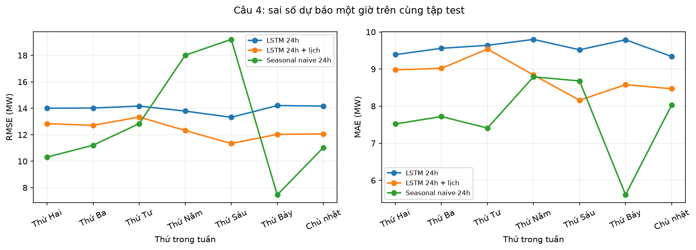
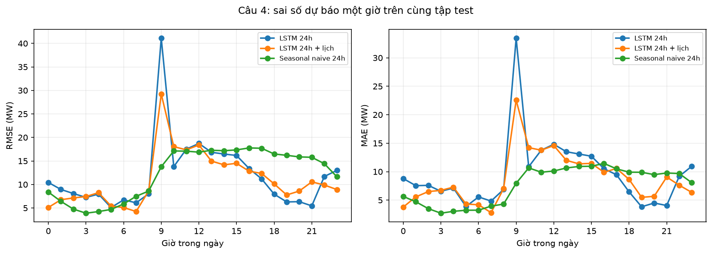
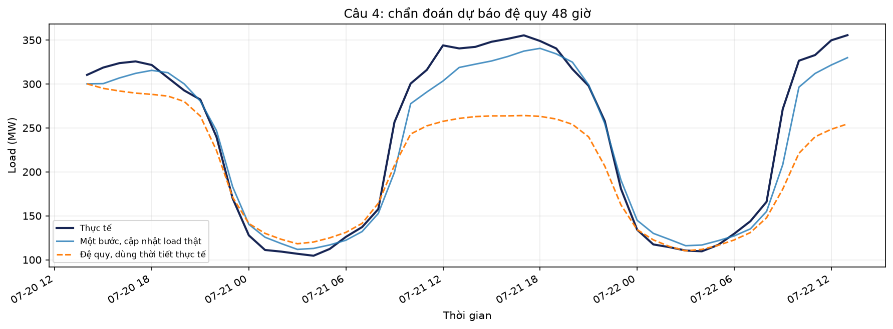

# Câu 4: LSTM học được chu kỳ nào? — Hoàng Nam

## Thiết kế thí nghiệm

Mô hình chính dùng 24 giờ gần nhất của load, nhiệt độ, độ ẩm và tốc độ gió; kiến trúc
LSTM(64) → LSTM(32) → Dense(1). Đánh giá dự báo một bước trên **3,946 giờ test**
từ 2014-07-20 14:00:00 đến 2014-12-31 23:00:00, dùng các quan sát thật trong cửa sổ quá khứ.
Biến thể giữ cửa sổ 24 giờ, thêm bốn đặc trưng sin/cos cho giờ trong ngày và thứ trong tuần
tại các mốc đầu vào. Số chiều đầu vào tăng từ 4 lên 8, nên số tham số cũng thay đổi.
Mô hình chính có **30,113 tham số**, thời gian huấn luyện
**164.33 giây**. Biến thể lịch có
**31,137 tham số**, thời gian huấn luyện
**175.79 giây**. Thời gian là số đo của từng lần chạy,
không bao gồm khâu chuẩn bị dữ liệu hay dự báo và có thể thay đổi theo tải máy.
Cấu hình được định trước; EarlyStopping dùng validation. Tập test chỉ dùng để báo cáo,
không dùng để chọn lại mô hình chính.

## Kết quả trên cùng tập test

| Model | RMSE | MAE | MAPE(%) |
| --- | --- | --- | --- |
| LSTM 24h | 13.96 | 9.57 | 4.75 |
| LSTM 24h + lịch | 12.40 | 8.81 | 4.20 |
| Seasonal naive 24h | 13.42 | 7.68 | 3.82 |

Đơn vị RMSE và MAE là MW; MAPE là %. Với seed 42, thêm đặc trưng lịch làm RMSE
giảm **11.17%** so với mô hình chính. Mỗi cấu hình chạy một seed;
chưa đủ để kết luận ưu thế ổn định. Biến thể lịch là thí nghiệm bổ sung;
`pred_lstm.csv` vẫn chứa dự báo mô hình chính 24 giờ, 4 biến.

Đối chiếu biến thể lịch với seasonal naive 24 giờ: RMSE thấp hơn (12.40 so với 13.42); MAE cao hơn hoặc bằng (8.81 so với 7.68); MAPE(%) cao hơn hoặc bằng (4.20 so với 3.82).
Vì các chỉ số đo các mặt khác nhau của sai số, cần đọc cả RMSE, MAE và MAPE
trước khi kết luận một cấu hình tốt hơn tổng thể.

## Sai số theo chu kỳ

Trong mô hình chính, Thứ Bảy có RMSE cao nhất (**14.21 MW**)
và Thứ Sáu thấp nhất (**13.32 MW**). Sai số theo thứ còn chịu ảnh hưởng
của mùa, mức tải và sự kiện trong tập test; khác biệt này không tự chứng minh mạng đã
hoặc chưa học được chu kỳ tuần.

## Trả lời câu 4

Cửa sổ 24 giờ cung cấp thông tin hình dạng và mức tải trong một ngày trước giờ dự báo.
Mạng có thể khai thác quan hệ giữa các giờ và các biến trong cửa sổ đó; sai số test đo mức hữu ích
của thông tin này. Cửa sổ không chứa trực tiếp quan sát cùng giờ của tuần trước (lag 168),
nên thí nghiệm lịch bổ sung tín hiệu vị trí trong ngày và tuần để kiểm tra phần thông tin còn thiếu.
RMSE giảm 11.17% trong lần chạy này, nhưng số đầu vào và số tham số là yếu tố cùng thay đổi.
Kết quả hỗ trợ nhận xét về lợi ích đặc trưng lịch trong cấu hình đã thử,
không phải bằng chứng tách biệt rằng LSTM đã học trọn chu kỳ tuần.

### Thí nghiệm thêm: đệ quy 48 giờ

Từ 2014-07-20 14:00:00 đến 2014-07-22 13:00:00, load dự báo được đưa trở lại cửa sổ,
không cập nhật load thực tế sau thời điểm bắt đầu. RMSE = **52.59 MW**,
MAE = **39.17 MW**, MAPE = **13.80%**.
Thời tiết tương lai dùng giá trị quan sát thực tế: đây là chẩn đoán có điều kiện với thời tiết đã biết,
không phải đánh giá vận hành khi chưa có dự báo thời tiết. Mô hình chính vẫn dự báo một bước.

