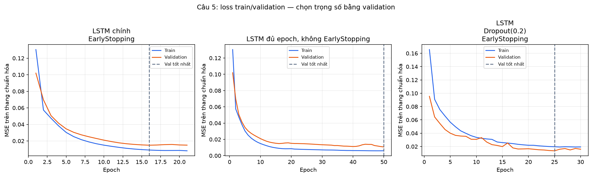

# Câu 5: LSTM có bị overfitting không? — Hoàng Nam

## Thí nghiệm kiểm tra

So sánh ba cấu hình định trước, cùng seed 42, cùng cửa sổ 24 giờ và cùng dữ liệu:
mô hình chính có EarlyStopping, mô hình đủ epoch không EarlyStopping,
và mô hình thêm Dropout(0.2) sau mỗi lớp LSTM với EarlyStopping. Cấu hình chính giữ nguyên;
không chọn biến thể theo sai số test.

## Kết quả

| Model | Epochs | Best val epoch | Train RMSE | Validation RMSE | Test RMSE | Training seconds |
| --- | --- | --- | --- | --- | --- | --- |
| LSTM chính + EarlyStopping | 21 | 16 | 12.02 | 9.76 | 13.96 | 164.33 |
| LSTM đủ epoch, không EarlyStopping | 50 | 50 | 8.96 | 8.29 | 11.36 | 397.80 |
| LSTM + Dropout(0.2) + EarlyStopping | 30 | 25 | 11.57 | 9.31 | 12.95 | 242.43 |

RMSE bằng MW sau khi đổi về thang gốc. Với EarlyStopping, trọng số lưu là epoch có
validation loss thấp nhất. Với biến thể không EarlyStopping, đánh giá trọng số **epoch cuối**,
dù cột `Best val epoch` có thể nằm sớm hơn. Thời gian đo chỉ gồm huấn luyện.

| Model | Split | RMSE | MAE | MAPE(%) |
| --- | --- | --- | --- | --- |
| LSTM chính + EarlyStopping | train | 12.02 | 8.22 | 4.11 |
| LSTM chính + EarlyStopping | validation | 9.76 | 6.65 | 3.48 |
| LSTM chính + EarlyStopping | test | 13.96 | 9.57 | 4.75 |
| LSTM đủ epoch, không EarlyStopping | train | 8.96 | 6.02 | 2.97 |
| LSTM đủ epoch, không EarlyStopping | validation | 8.29 | 5.58 | 3.00 |
| LSTM đủ epoch, không EarlyStopping | test | 11.36 | 7.39 | 3.64 |
| LSTM + Dropout(0.2) + EarlyStopping | train | 11.57 | 7.61 | 3.61 |
| LSTM + Dropout(0.2) + EarlyStopping | validation | 9.31 | 6.02 | 3.01 |
| LSTM + Dropout(0.2) + EarlyStopping | test | 12.95 | 8.18 | 3.65 |

## Trả lời câu 5

**Chưa thấy bằng chứng rõ của overfitting từ diễn biến train/validation sau epoch tốt nhất.** Không quan sát đồng thời train loss tiếp tục giảm và validation loss tăng ở hai mốc so sánh. Việc validation cuối lớn hơn giá trị nhỏ nhất của chính nó không đủ để kết luận overfitting.

Ở lần chạy đủ epoch, validation tốt nhất xuất hiện tại epoch 50, sau thời điểm mô hình chính đã dừng (epoch 21). Validation có thể cải thiện trở lại sau một đoạn chững; patience=5 của mô hình chính đã dừng trước lần cải thiện muộn này. EarlyStopping không bảo đảm tìm được checkpoint tốt nhất của toàn bộ lịch huấn luyện dài hơn. Đây là quan sát trên validation; mô hình chính vẫn giữ đúng cấu hình đã định trước.

Mô hình chính chạy 21 epoch và dùng trọng số ở epoch
16. Validation MSE tốt nhất 0.014867,
so với 0.014949 ở epoch cuối đã chạy. RMSE validation thấp hơn RMSE train
**2.26 MW** (9.76 so với 12.02 MW).
Chênh lệch cần đọc cùng đường loss: các tập là các giai đoạn thời gian khác nhau,
nên thay đổi mùa và phân phối cũng có thể tạo chênh lệch, không chỉ overfitting.

Ở biến thể đủ epoch, từ epoch **50** (validation tốt nhất) tới epoch
**50**, train MSE đổi từ **0.006034** thành **0.006034**
(chênh lệch cuối − đầu **+0.000000**, mức giảm **-0.00%**);
validation MSE từ **0.010738** thành **0.010738**
(chênh lệch **+0.000000**, mức tăng **+0.00%**).
Trung bình 1 epoch cuối: train MSE **0.006034**,
validation MSE **0.010738**. Các đại lượng này đều ở thang chuẩn hóa.
Chẩn đoán phân kỳ rõ dùng quy tắc mô tả: có ít nhất 5 epoch sau mốc tốt nhất,
train giảm trên 1%, validation tăng trên 1%, và trung bình tối đa 5 epoch cuối cùng cùng chiều.
Đây là quy tắc đọc kết quả của thí nghiệm, không phải kiểm định thống kê.

EarlyStopping hạn chế tiếp tục học khi validation không cải thiện; Dropout là thử nghiệm
regularization bổ sung. Một seed chưa đủ để khẳng định mức cải thiện ổn định.
