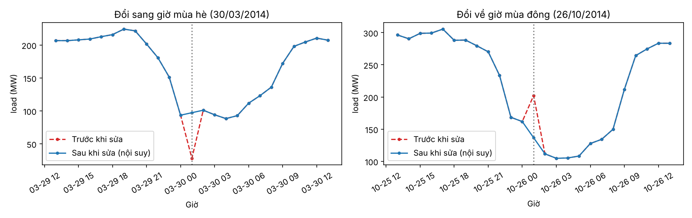
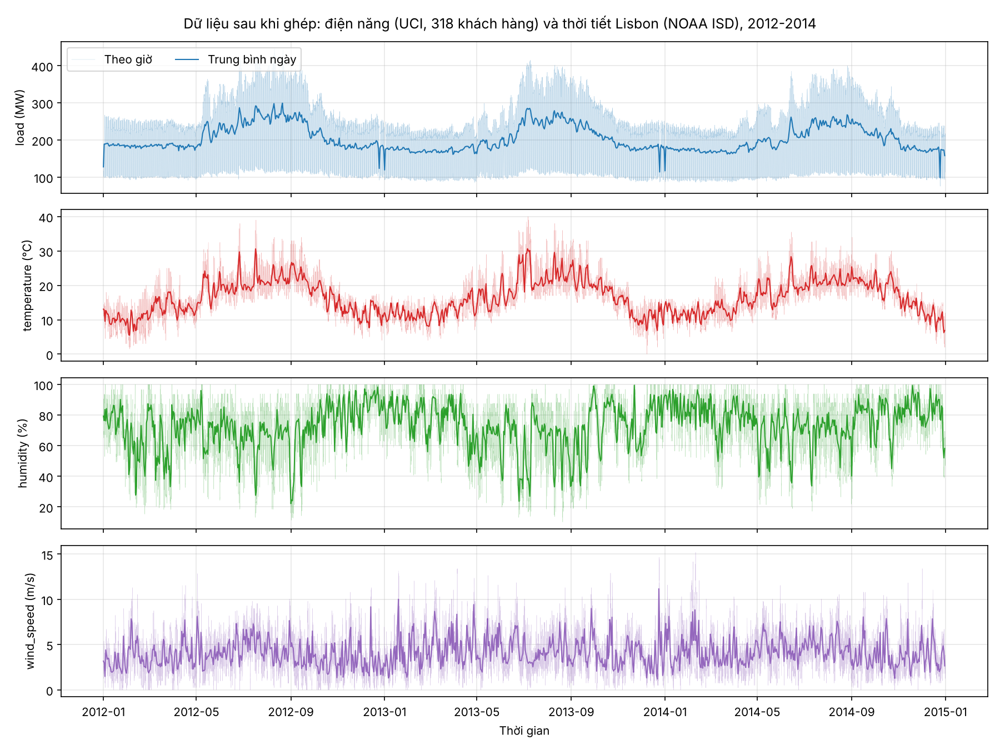

# Mục 2: Dataset và bài toán (Thành)

## 2.1. Bài toán

Tại mỗi giờ t có vector quan sát X_t = [load_t, temperature_t, humidity_t, wind_speed_t]. Dùng 24 giờ gần nhất X_{t−23:t} để dự báo điện năng giờ tiếp theo load_{t+1}.

## 2.2. Nguồn dữ liệu

Đề yêu cầu bộ Electricity Load Diagrams (UCI) với 4 biến load, temperature, humidity, wind_speed. Tuy nhiên bộ **ElectricityLoadDiagrams20112014** của UCI **chỉ có điện năng**, không có thời tiết. Vì vậy nhóm ghép thêm số đo thời tiết thật của trạm khí tượng sân bay Lisbon, cùng khu vực (Bồ Đào Nha) và cùng thời gian.

| | Điện năng | Thời tiết |
|---|---|---|
| Nguồn | UCI ElectricityLoadDiagrams20112014 | NOAA Integrated Surface Database (ISD) |
| Nội dung | Công suất tiêu thụ của 370 khách hàng ở Bồ Đào Nha | Bản tin quan trắc METAR của trạm Lisboa/Portela (LPPT, mã 085360-99999) |
| Tần suất gốc | 15 phút | 30 phút |
| Giờ | Giờ địa phương Bồ Đào Nha | UTC |
| Số bản ghi gốc | 140.256 mốc x 370 khách hàng (2011 đến 2014) | 52.720 bản tin (2012 đến 2014) |

## 2.3. Dữ liệu sau khi ghép

File `data/processed/load_weather_hourly.csv`: **26.304 giờ**, từ 01/01/2012 00:00 đến 31/12/2014 23:00, mỗi giờ đúng 1 dòng, không thiếu.

| Biến | Đơn vị | Cách tạo | Trung bình | Độ lệch chuẩn | Nhỏ nhất | Lớn nhất |
|---|---|---|---|---|---|---|
| `load` | MW | Tổng 318 khách hàng, trung bình trong giờ | 203,3 | 79,6 | 75,7 (25/12/2014 05:00) | 445,8 (10/08/2012 16:00) |
| `temperature` | °C | Trung bình các bản tin trong giờ | 16,4 | 5,7 | 0,0 | 40,0 |
| `humidity` | % | Tính từ nhiệt độ và điểm sương (công thức Magnus) | 72,8 | 18,5 | 10,1 | 100,0 |
| `wind_speed` | m/s | Trung bình các bản tin trong giờ | 4,1 | 2,1 | 0,0 | 15,2 |

Chia theo thời gian 70/15/15 (cấu hình chung trong `utils.py`):

| Tập | Số giờ | Từ | Đến |
|---|---|---|---|
| Train | 18.412 | 01/01/2012 00:00 | 06/02/2014 03:00 |
| Validation | 3.946 | 06/02/2014 04:00 | 20/07/2014 13:00 |
| Test | 3.946 | 20/07/2014 14:00 | 31/12/2014 23:00 |

## 2.4. Các vấn đề đã xử lý

| Vấn đề | Số lượng | Cách xử lý |
|---|---|---|
| Khách hàng đăng ký muộn (giá trị 0 ở đầu) hoặc ngừng sớm | 52 khách hàng (50 bắt đầu sau 02/01/2012, 2 ngừng trước 30/12/2014) | Bỏ, chỉ giữ 318 khách hàng có dữ liệu suốt 3 năm, để tổng không nhảy bậc khi có khách hàng mới |
| Ngày đổi sang giờ mùa hè: giờ 1:00 đến 2:00 bằng 0 | 3 giờ (25/03/2012, 31/03/2013, 30/03/2014) | Đặt NaN, nội suy (ví dụ 30/03/2014 01:00 từ 28,1 MW thành khoảng 97 MW) |
| Ngày đổi về giờ mùa đông: giờ 1:00 đến 2:00 cộng dồn 2 giờ | 3 giờ (28/10/2012, 27/10/2013, 26/10/2014) | Đặt NaN, nội suy (ví dụ 26/10/2014 01:00 từ 202,2 MW thành khoảng 137 MW) |
| Bản tin thời tiết có mã chất lượng xấu | 1 nhiệt độ, 25 điểm sương | Bỏ |
| Giờ không có bản tin thời tiết | 104 giờ (0,4%), gồm 7 giờ lẻ và 6 đoạn dài 2 đến 24 giờ | Đoạn ≤ 3 giờ: nội suy tuyến tính; đoạn dài hơn: trung bình cùng giờ của hôm trước và hôm sau, để giữ chu kỳ ngày |

**Hình 2.1.** Load quanh 2 ngày đổi giờ năm 2014, trước và sau khi sửa.

## 2.5. Nhìn tổng quan 4 biến

**Hình 2.2.** 4 biến theo giờ (mờ) và trung bình ngày (đậm), 2012 đến 2014.

Nhận xét nhanh (Phạm Lê Văn Bảo phân tích kỹ ở mục 3):

1. **Load cao nhất vào mùa hè** (trung bình tháng 8 khoảng 258 MW so với khoảng 174 đến 178 MW từ tháng 12 đến tháng 3), trùng với lúc nhiệt độ cao nhất (tháng 8 trung bình 22,3 °C). Mùa đông Lisbon ấm nên không thấy đỉnh sưởi rõ.
2. Tương quan Pearson của load với thời tiết: **temperature +0,66**, humidity −0,53, wind_speed +0,28. Độ ẩm tương quan âm vì mùa hè khô và nóng.
3. Load có chu kỳ ngày rất mạnh (dải mờ rộng từ khoảng 100 đến 250 MW trong cùng một ngày mùa đông) và giảm sâu vào các ngày lễ (Giáng sinh, năm mới).
4. Tập test (20/07 đến 31/12/2014) đi qua cả mùa hè và chuyển sang mùa đông, nên mô hình phải xử lý được sự thay đổi mức load theo mùa.
