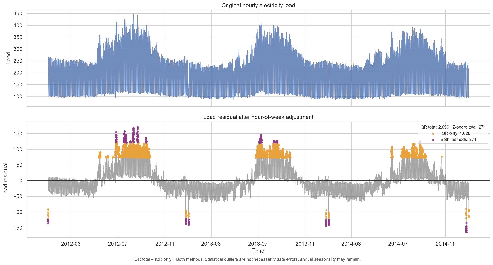
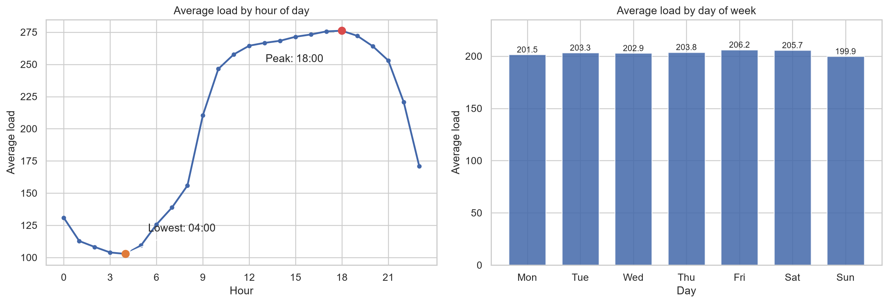
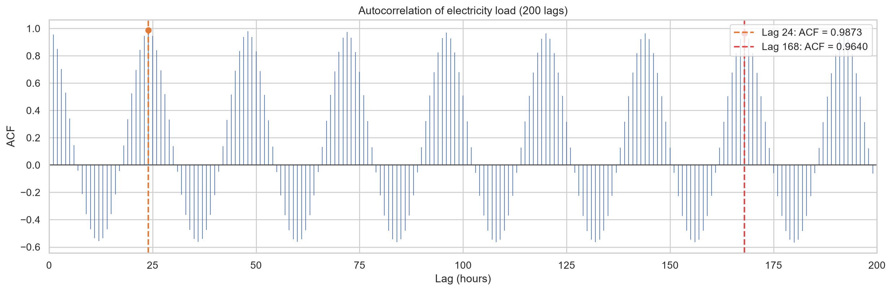
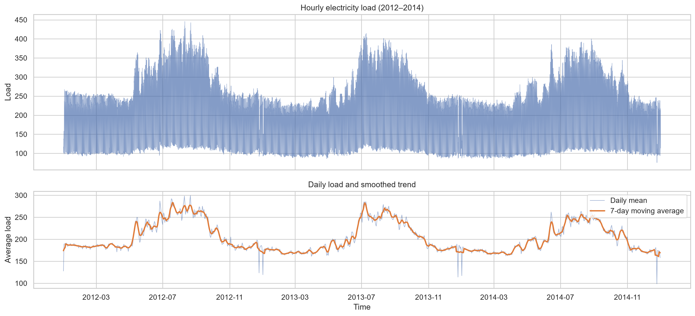
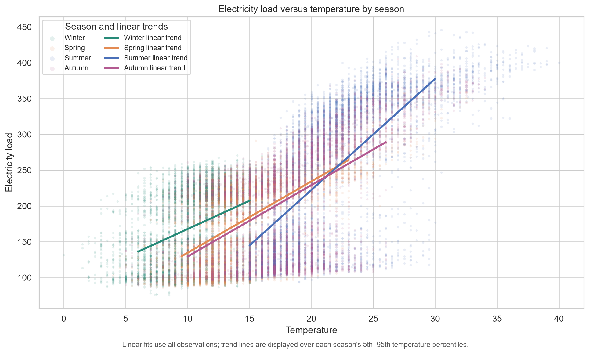
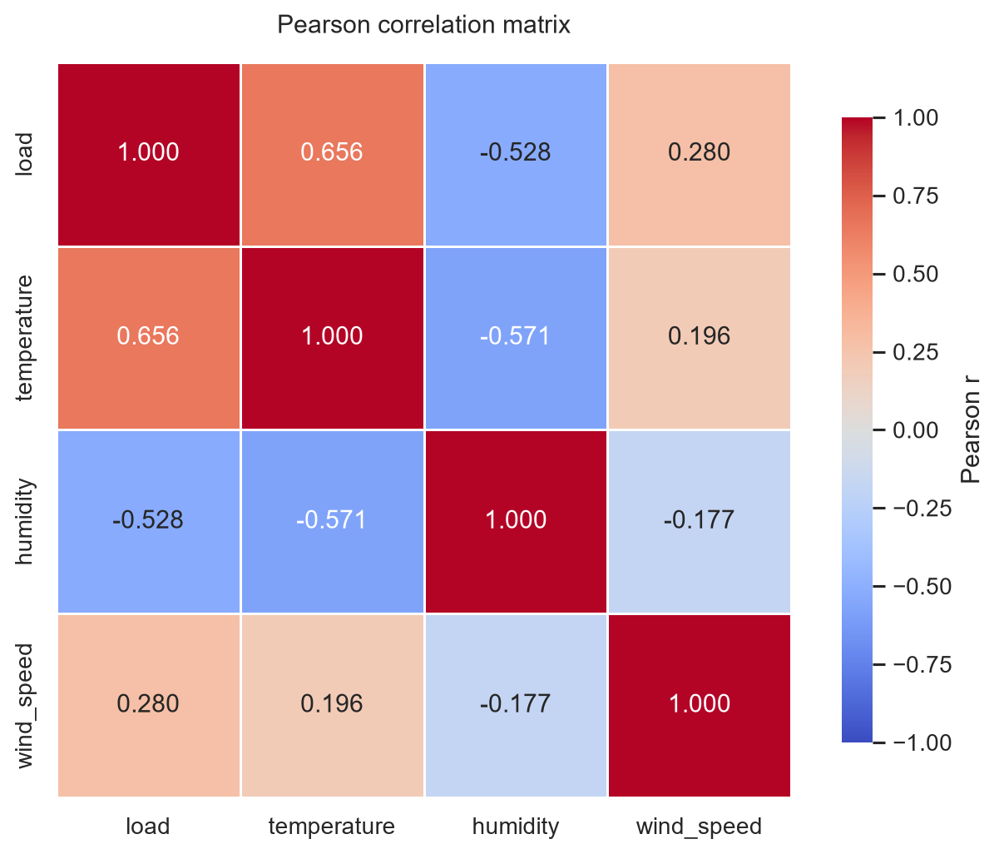

# MỤC 3. DATA UNDERSTANDING – PHÂN TÍCH KHÁM PHÁ DỮ LIỆU

## 3.1. Mục tiêu

Giai đoạn Data Understanding được thực hiện nhằm tìm hiểu cấu trúc, chất lượng và những đặc điểm thống kê của bộ dữ liệu phụ tải điện kết hợp với dữ liệu thời tiết trước khi xây dựng mô hình dự báo.

Các nội dung phân tích bao gồm:

- Kiểm tra số lượng giá trị thiếu của từng biến.
- Phát hiện ngoại lai bằng IQR và Z-score.
- Điều chỉnh phụ tải theo chu kỳ giờ-trong-tuần trước khi phân tích ngoại lai.
- Xác định chu kỳ tiêu thụ điện theo giờ trong ngày và theo thứ trong tuần.
- Phân tích tự tương quan ACF trong 200 độ trễ.
- Khảo sát biến động phụ tải theo thời gian.
- Trực quan hóa quan hệ giữa phụ tải và nhiệt độ theo mùa.
- Phân tích ma trận tương quan Pearson giữa phụ tải và các biến thời tiết.

Kết quả EDA cung cấp cơ sở để nhận diện cấu trúc thời gian, đánh giá các yếu tố liên quan đến phụ tải và định hướng các bước xử lý dữ liệu, xây dựng đặc trưng, huấn luyện mô hình tiếp theo.

## 3.2. Tổng quan bộ dữ liệu

Dữ liệu đầu vào được lấy từ tệp:

`data/processed/load_weather_hourly.csv`

Đây là dữ liệu đã được chuẩn bị và đồng bộ ở Mục 2. Chương trình phân tích đọc dữ liệu thông qua hàm `load_data()` trong `src/utils.py`.

Bộ dữ liệu gồm **26.304 quan sát theo giờ**, từ 00:00 ngày 01/01/2012 đến 23:00 ngày 31/12/2014.

| Trường dữ liệu | Ý nghĩa |
|---|---|
| `Datetime` | Mốc thời gian của quan sát, tần suất một giờ |
| `load` | Phụ tải điện |
| `temperature` | Nhiệt độ không khí |
| `humidity` | Độ ẩm không khí |
| `wind_speed` | Tốc độ gió |

`Datetime` được sử dụng làm chỉ số thời gian. Bốn biến còn lại là các biến số được dùng trong phân tích.

Trong Mục 3, dữ liệu được giữ ở thang đo ban đầu. Chưa thực hiện chuẩn hóa StandardScaler, chia tập train/validation/test hoặc huấn luyện mô hình.

## 3.3. Kiểm tra giá trị thiếu

### 3.3.1. Phương pháp

Số giá trị thiếu được kiểm tra riêng cho từng biến bằng phương thức `isna().sum()` của pandas.

Tỷ lệ thiếu được tính bằng số giá trị thiếu chia cho tổng số quan sát, nhân với 100%.

### 3.3.2. Kết quả

**Bảng 3.1. Thống kê giá trị thiếu sau tiền xử lý**

| Biến | Số giá trị thiếu | Tỷ lệ thiếu |
|---|---:|---:|
| `load` | 0 | 0,00% |
| `temperature` | 0 | 0,00% |
| `humidity` | 0 | 0,00% |
| `wind_speed` | 0 | 0,00% |

Cả bốn biến đều không có giá trị thiếu trong bộ dữ liệu đầu vào của Mục 3.

### 3.3.3. Nhận xét

Kết quả cho thấy dữ liệu sau bước chuẩn bị đã có đầy đủ giá trị tại các mốc thời gian được sử dụng. Đây là điều kiện thuận lợi cho việc tính ACF, tương quan Pearson và các thống kê mô tả.

Tuy nhiên, cần phân biệt dữ liệu đã xử lý với dữ liệu gốc. Theo kết quả thực hiện ở Mục 2, nhóm đã xử lý các bất thường liên quan đến chuyển đổi giờ mùa hè và bổ sung những mốc thời tiết còn thiếu.

Vì vậy, việc không còn NaN không có nghĩa dữ liệu ban đầu hoàn toàn đầy đủ. Các giá trị được bổ sung ở bước trước vẫn có thể chứa sai số ước lượng.

Mục 3 chỉ kiểm tra lại kết quả đầu vào, không thực hiện nội suy hoặc chỉnh sửa dữ liệu thêm lần nữa.

## 3.4. Phân tích ngoại lai

### 3.4.1. Phương pháp IQR và Z-score

Hai phương pháp được sử dụng để đánh dấu những quan sát có độ lệch thống kê lớn.

**Phương pháp IQR**

Khoảng tứ phân vị được xác định bởi:

\[
IQR=Q_3-Q_1
\]

Trong đó, \(Q_1\) là phân vị 25% và \(Q_3\) là phân vị 75%.

Một quan sát được đánh dấu ngoại lai nếu:

\[
x<Q_1-1.5IQR
\]

hoặc:

\[
x>Q_3+1.5IQR
\]

**Phương pháp Z-score**

Z-score được tính theo công thức:

\[
z_i=\frac{x_i-\mu}{\sigma}
\]

Trong đó, \(\mu\) là giá trị trung bình và \(\sigma\) là độ lệch chuẩn của chuỗi.

Một quan sát được đánh dấu ngoại lai khi:

\[
|z_i|>3
\]

IQR dựa trên các phân vị của phân bố, trong khi Z-score dựa trên khoảng cách đến trung bình tính theo độ lệch chuẩn. Việc sử dụng đồng thời hai phương pháp giúp đối chiếu kết quả và nhận diện mức độ khác biệt giữa các tiêu chí.

### 3.4.2. Thống kê ngoại lai trên dữ liệu gốc

**Bảng 3.2. Kết quả IQR và Z-score trên từng biến gốc**

| Biến | IQR | IQR (%) | Z-score | Z-score (%) |
|---|---:|---:|---:|---:|
| `load` | 9 | 0,034% | 3 | 0,011% |
| `temperature` | 219 | 0,833% | 125 | 0,475% |
| `humidity` | 127 | 0,483% | 54 | 0,205% |
| `wind_speed` | 321 | 1,220% | 173 | 0,658% |

Trên dữ liệu gốc, tốc độ gió có tỷ lệ quan sát được đánh dấu cao nhất trong ba biến thời tiết, với 321 điểm theo IQR và 173 điểm theo Z-score.

Nhiệt độ có 219 điểm IQR và 125 điểm Z-score, trong khi độ ẩm có 127 điểm IQR và 54 điểm Z-score.

Đối với phụ tải gốc, hai phương pháp chỉ đánh dấu lần lượt 9 và 3 điểm. Tuy nhiên, kết quả này chưa phản ánh đầy đủ những biến động bất thường so với mức phụ tải thường gặp ở từng thời điểm trong tuần.

### 3.4.3. Phát hiện ngoại lai trên phần dư phụ tải

Phụ tải điện có chu kỳ theo giờ trong ngày và theo thứ trong tuần. Chẳng hạn, một mức phụ tải được xem là bình thường vào giờ cao điểm có thể rất khác so với mức phụ tải thông thường vào ban đêm.

Do đó, nhóm thực hiện điều chỉnh phụ tải theo trung bình giờ-trong-tuần trước khi áp dụng IQR và Z-score.

Một tuần gồm 168 nhóm giờ, tương ứng với 7 ngày và 24 giờ mỗi ngày.

Gọi \(L_t\) là phụ tải tại thời điểm \(t\), và \(\overline{L}_{g(t)}\) là phụ tải trung bình của nhóm giờ-trong-tuần chứa thời điểm đó.

Phần dư được tính bằng:

\[
r_t=L_t-\overline{L}_{g(t)}
\]

Phần dư dương cho biết phụ tải cao hơn mức trung bình của cùng giờ và cùng thứ; phần dư âm cho biết phụ tải thấp hơn mức trung bình tương ứng.

Sau khi tính phần dư, nhóm áp dụng IQR và Z-score trên chuỗi \(r_t\).

**Bảng 3.3. Ngoại lai trên phần dư phụ tải**

| Phương pháp | Số điểm | Tỷ lệ |
|---|---:|---:|
| IQR | 2.099 | 7,980% |
| Z-score | 271 | 1,030% |

Để làm rõ quan hệ giữa hai phương pháp, các điểm được phân thành ba nhóm:

**Bảng 3.4. Mức độ trùng nhau giữa IQR và Z-score**

| Nhóm | Số điểm |
|---|---:|
| Chỉ được IQR đánh dấu | 1.828 |
| Chỉ được Z-score đánh dấu | 0 |
| Được cả hai phương pháp đánh dấu | 271 |
| Tổng số điểm IQR | 2.099 |
| Tổng số điểm Z-score | 271 |

Toàn bộ 271 điểm được Z-score phát hiện cũng thuộc nhóm được IQR phát hiện.

Do đó:

\[
2.099=1.828+271
\]

Điều này cho thấy IQR đánh dấu nhiều quan sát hơn Z-score trên chuỗi phần dư, trong khi Z-score tập trung vào một tập con có độ lệch thống kê lớn.

### 3.4.4. Biểu đồ ngoại lai

*Hình 3.1. Phụ tải điện gốc và ngoại lai trên phần dư sau điều chỉnh giờ-trong-tuần.*

Biểu đồ phía trên thể hiện phụ tải điện gốc trong giai đoạn 2012–2014. Biểu đồ phía dưới thể hiện phần dư sau khi trừ mức phụ tải trung bình theo giờ-trong-tuần.

Trên biểu đồ phần dư:

- Các điểm màu cam được IQR đánh dấu nhưng không được Z-score đánh dấu.
- Các điểm màu tím được cả IQR và Z-score đánh dấu.
- Đường màu xám thể hiện toàn bộ chuỗi phần dư.

Các điểm có phần dư dương lớn tập trung thành từng cụm trong những giai đoạn phụ tải tăng mạnh, nổi bật là các tháng giữa năm. Ngoài ra, một số điểm có phần dư âm lớn xuất hiện tại những thời điểm phụ tải giảm đột ngột.

Kết quả này cho thấy các giá trị được đánh dấu không phân bố hoàn toàn ngẫu nhiên theo thời gian mà có liên hệ với các giai đoạn biến động mạnh của phụ tải.

### 3.4.5. Giải thích và giới hạn

Sự khác biệt giữa số điểm ngoại lai trên phụ tải gốc và phần dư không có nghĩa dữ liệu đã phát sinh thêm lỗi.

Khi sử dụng phần dư, các quan sát được so sánh với mức phụ tải trung bình của cùng giờ và cùng thứ trong tuần, thay vì chỉ xét độ lệch trên toàn bộ phân bố phụ tải gốc.

Tuy nhiên, phương pháp này mới điều chỉnh chu kỳ giờ-trong-tuần, **chưa loại bỏ mùa vụ hằng năm**.

Vì vậy, những đợt phụ tải tăng cao kéo dài vào mùa hè vẫn có thể tạo ra phần dư dương lớn và bị đánh dấu là ngoại lai.

Các điểm ngoại lai trong kết quả EDA chỉ là những quan sát cần chú ý theo tiêu chí thống kê. Không thể mặc nhiên kết luận chúng là lỗi đo lường hoặc dữ liệu sai.

Trong Mục 3, nhóm không tự động xóa hoặc thay thế các điểm được đánh dấu, nhằm bảo toàn những biến động thực tế có thể hữu ích cho bài toán dự báo.

## 3.5. Phân tích chu kỳ phụ tải theo giờ và theo thứ

### 3.5.1. Phụ tải trung bình theo giờ trong ngày

Phụ tải được nhóm theo 24 giờ trong ngày, sau đó tính giá trị trung bình của từng nhóm trên toàn bộ dữ liệu.

*Hình 3.2. Phụ tải trung bình theo giờ trong ngày và theo thứ trong tuần.*

Kết quả cho thấy phụ tải thay đổi rõ rệt trong ngày.

Mức phụ tải trung bình thấp nhất xuất hiện vào **04:00**, xấp xỉ 103 đơn vị phụ tải. Sau thời điểm này, phụ tải bắt đầu tăng, đặc biệt rõ từ buổi sáng.

Phụ tải tiếp tục duy trì ở mức cao trong phần lớn thời gian ban ngày và đạt đỉnh vào **18:00**, xấp xỉ 276 đơn vị phụ tải, trước khi giảm vào buổi tối.

Chênh lệch giữa hai thời điểm cực trị vào khoảng 173 đơn vị phụ tải.

Đây là bằng chứng trực quan cho thấy giờ trong ngày có liên hệ rất rõ với mức tiêu thụ điện.

### 3.5.2. Phụ tải trung bình theo thứ trong tuần

**Bảng 3.5. Phụ tải trung bình theo thứ**

| Thứ | Phụ tải trung bình |
|---|---:|
| Thứ Hai | 201,5 |
| Thứ Ba | 203,3 |
| Thứ Tư | 202,9 |
| Thứ Năm | 203,8 |
| Thứ Sáu | 206,2 |
| Thứ Bảy | 205,7 |
| Chủ Nhật | 199,9 |

Thứ Sáu có mức phụ tải trung bình cao nhất, khoảng 206,2. Chủ Nhật có mức thấp nhất, khoảng 199,9.

Chênh lệch giữa hai ngày là khoảng 6,3 đơn vị phụ tải.

So với chu kỳ theo giờ, sự khác biệt giữa các thứ trong tuần nhỏ hơn đáng kể khi xét trên giá trị trung bình ngày.

Tuy nhiên, điều này không đồng nghĩa chu kỳ tuần không tồn tại. Sự lặp lại theo tuần còn thể hiện qua mức phụ tải tại cùng giờ và cùng thứ, được làm rõ hơn bằng phân tích ACF.

### 3.5.3. Nhận xét chung

Kết quả cho thấy chu kỳ 24 giờ là đặc điểm nổi bật của phụ tải.

Chu kỳ theo thứ cũng tồn tại nhưng có mức chênh lệch trung bình nhỏ hơn. Điều này gợi ý rằng các thông tin về giờ và thứ có thể hữu ích khi xây dựng đặc trưng thời gian cho mô hình dự báo.

## 3.6. Phân tích tự tương quan ACF

### 3.6.1. Mục đích

Hàm tự tương quan ACF được sử dụng để đánh giá mối liên hệ giữa phụ tải hiện tại và phụ tải ở các thời điểm quá khứ.

Phân tích được thực hiện trên chuỗi `load` gốc với 200 độ trễ, tương ứng 200 giờ.

Hai độ trễ được chú trọng là:

- Lag 24: cùng giờ của ngày trước.
- Lag 168: cùng giờ và cùng thứ của tuần trước.

### 3.6.2. Kết quả

*Hình 3.3. ACF của phụ tải điện trong 200 độ trễ.*

**Bảng 3.6. Hệ số ACF tại các độ trễ quan trọng**

| Độ trễ | ACF |
|---|---:|
| 24 giờ | 0,9873 |
| 168 giờ | 0,9640 |

ACF tại lag 24 đạt 0,9873, cho thấy phụ tải tại cùng giờ của hai ngày liên tiếp có mức tự tương quan rất cao.

ACF tại lag 168 đạt 0,9640, cho thấy chuỗi cũng có sự lặp lại mạnh theo tuần.

Trên biểu đồ, các đỉnh ACF xuất hiện lặp lại gần những độ trễ là bội số của 24 giờ. Xen giữa là những vùng tự tương quan âm, phản ánh sự khác biệt giữa các pha phụ tải cao và thấp trong ngày.

### 3.6.3. Ý nghĩa

Kết quả ACF củng cố nhận định rằng chuỗi phụ tải có tính chu kỳ rõ rệt.

Các độ trễ 24 và 168 giờ có thể được xem xét khi xây dựng đặc trưng quá khứ hoặc các phương pháp dự báo theo mùa.

Tuy nhiên, ACF cao không đồng nghĩa mô hình chắc chắn dự báo chính xác. Chuỗi được phân tích ở dạng gốc nên các thành phần mùa vụ và biến động dài hạn vẫn ảnh hưởng đến hệ số tự tương quan.

Việc lựa chọn đặc trưng và đánh giá hiệu quả dự báo cần được thực hiện trên tập dữ liệu phù hợp trong các bước tiếp theo.

## 3.7. Phân tích phụ tải theo thời gian

*Hình 3.4. Phụ tải theo giờ, phụ tải trung bình ngày và đường trung bình trượt 7 ngày.*

Biểu đồ phía trên thể hiện toàn bộ chuỗi phụ tải theo giờ trong ba năm. Biểu đồ phía dưới thể hiện phụ tải trung bình ngày cùng đường trung bình trượt 7 ngày.

Có thể nhận thấy ba đặc điểm.

**Thứ nhất, phụ tải biến động mạnh theo giờ.** Trong cùng một ngày, mức phụ tải có thể thay đổi đáng kể giữa giờ thấp điểm và giờ cao điểm. Đây là nguyên nhân khiến biểu đồ theo giờ có mật độ đường rất dày.

**Thứ hai, phụ tải có tính mùa vụ hằng năm.** Trong cả ba năm, những giai đoạn giữa năm thường xuất hiện các đợt tăng phụ tải rõ rệt. Mức tăng và thời gian duy trì phụ tải cao có khác biệt giữa các năm.

**Thứ ba, chuỗi xuất hiện một số đợt giảm đột ngột.** Những điểm này cần được xem xét trong bối cảnh thời gian và dữ liệu gốc; chỉ dựa vào biểu đồ chưa đủ để kết luận nguyên nhân.

Đường trung bình trượt 7 ngày làm giảm biến động ngắn hạn và giúp nhận diện các giai đoạn phụ tải tăng hoặc giảm kéo dài.

Nhìn chung, chuỗi phụ tải vừa có biến động ngắn hạn theo giờ, vừa có biến động chậm hơn theo mùa. Đây là đặc điểm quan trọng cần lưu ý trong bài toán dự báo chuỗi thời gian.

## 3.8. Quan hệ giữa phụ tải và nhiệt độ theo mùa

### 3.8.1. Phương pháp

Biểu đồ phân tán được sử dụng để khảo sát mối quan hệ giữa nhiệt độ và phụ tải.

- Trục hoành: `temperature`.
- Trục tung: `load`.
- Màu sắc: mùa trong năm.

Các mùa được xác định theo tháng:

| Mùa | Tháng |
|---|---|
| Winter | 12, 1, 2 |
| Spring | 3, 4, 5 |
| Summer | 6, 7, 8 |
| Autumn | 9, 10, 11 |

Ngoài các điểm dữ liệu, biểu đồ có đường hồi quy tuyến tính riêng cho từng mùa.

Các đường hồi quy được ước lượng trên toàn bộ quan sát hợp lệ của mùa tương ứng nhưng chỉ hiển thị trong khoảng phân vị nhiệt độ 5%–95% để hạn chế kéo dài đường xu hướng vào những vùng có ít dữ liệu.

### 3.8.2. Kết quả

*Hình 3.5. Biểu đồ phân tán phụ tải và nhiệt độ theo mùa, kèm đường xu hướng tuyến tính.*

Biểu đồ cho thấy phụ tải nhìn chung có xu hướng tăng khi nhiệt độ tăng, đặc biệt trong những khoảng nhiệt độ cao.

Mùa hè có nhiều quan sát nằm ở vùng nhiệt độ cao và phụ tải lớn. Đường xu hướng của mùa hè có độ dốc dương rõ rệt.

Các mùa khác cũng có đường xu hướng dương, nhưng độ dốc và phạm vi nhiệt độ quan sát khác nhau.

Tuy nhiên, các điểm dữ liệu phân tán rộng theo chiều dọc. Tại cùng một mức nhiệt độ, phụ tải vẫn có thể khác biệt đáng kể.

Điều này cho thấy nhiệt độ không phải yếu tố duy nhất liên quan đến phụ tải. Giờ trong ngày, thứ trong tuần và các điều kiện vận hành khác cũng có thể góp phần tạo ra sự khác biệt.

### 3.8.3. Giới hạn

Đường hồi quy chỉ mô tả xu hướng tuyến tính trong từng mùa, không phải đường dự báo phụ tải chính thức.

Việc giới hạn đoạn đường hiển thị trong khoảng phân vị 5%–95% không làm thay đổi dữ liệu dùng để ước lượng hệ số hồi quy.

Biểu đồ cũng không chứng minh quan hệ nhân quả giữa nhiệt độ và phụ tải.

Để đánh giá đầy đủ hơn ảnh hưởng của các yếu tố thời tiết, cần xem xét thêm tương quan theo mùa, tương quan có độ trễ và các phương pháp kiểm soát chu kỳ thời gian.

## 3.9. Ma trận tương quan Pearson

### 3.9.1. Phương pháp

Hệ số tương quan Pearson được sử dụng để đánh giá mức độ liên hệ tuyến tính giữa các cặp biến.

Giá trị hệ số nằm trong khoảng từ -1 đến 1:

- Giá trị dương: hai biến có xu hướng tăng hoặc giảm cùng chiều.
- Giá trị âm: hai biến có xu hướng biến động ngược chiều.
- Giá trị gần 0: mối liên hệ tuyến tính yếu.

### 3.9.2. Kết quả

*Hình 3.6. Ma trận tương quan Pearson giữa phụ tải và các biến thời tiết.*

**Bảng 3.7. Hệ số tương quan Pearson**

| Biến | load | temperature | humidity | wind_speed |
|---|---:|---:|---:|---:|
| load | 1,0000 | 0,6559 | -0,5277 | 0,2803 |
| temperature | 0,6559 | 1,0000 | -0,5711 | 0,1963 |
| humidity | -0,5277 | -0,5711 | 1,0000 | -0,1773 |
| wind_speed | 0,2803 | 0,1963 | -0,1773 | 1,0000 |

### 3.9.3. Phân tích kết quả

**Phụ tải và nhiệt độ:** hệ số Pearson bằng 0,6559, thể hiện tương quan tuyến tính dương tương đối rõ. Trong dữ liệu quan sát, nhiệt độ cao thường đi kèm phụ tải lớn hơn.

**Phụ tải và độ ẩm:** hệ số bằng -0,5277, thể hiện tương quan tuyến tính âm. Tuy nhiên, độ ẩm cũng có tương quan âm với nhiệt độ, nên không thể tách biệt hoàn toàn các mối liên hệ này chỉ bằng hệ số Pearson.

**Phụ tải và tốc độ gió:** hệ số bằng 0,2803, cho thấy tương quan tuyến tính dương yếu hơn hai biến còn lại.

**Nhiệt độ và độ ẩm:** hệ số bằng -0,5711, phản ánh mối liên hệ ngược chiều tương đối rõ giữa hai biến thời tiết trong bộ dữ liệu.

Xét theo trị tuyệt đối của hệ số Pearson với phụ tải, nhiệt độ đứng đầu, tiếp theo là độ ẩm và tốc độ gió.

Tuy nhiên, Pearson chỉ phản ánh tương quan tuyến tính đồng thời. Kết quả không chứng minh quan hệ nhân quả và chưa đánh giá được các quan hệ phi tuyến hoặc tác động trễ.

## 3.10. Tổng hợp kết quả

**Bảng 3.8. Tổng hợp những phát hiện chính**

| Nội dung | Kết quả |
|---|---|
| Quy mô dữ liệu | 26.304 quan sát theo giờ |
| Giai đoạn | 01/01/2012 – 31/12/2014 |
| Giá trị thiếu | 0 ở cả bốn biến |
| IQR trên phần dư load | 2.099 điểm (7,980%) |
| Z-score trên phần dư load | 271 điểm (1,030%) |
| IQR temperature | 219 điểm |
| IQR humidity | 127 điểm |
| IQR wind_speed | 321 điểm |
| Giờ phụ tải thấp nhất | 04:00 |
| Giờ phụ tải cao nhất | 18:00 |
| Thứ có phụ tải trung bình cao nhất | Thứ Sáu |
| ACF lag 24 | 0,9873 |
| ACF lag 168 | 0,9640 |
| Pearson(load, temperature) | 0,6559 |
| Pearson(load, humidity) | -0,5277 |
| Pearson(load, wind_speed) | 0,2803 |

## 3.11. Kết luận

Kết quả phân tích khám phá cho thấy bộ dữ liệu sau tiền xử lý không còn giá trị thiếu và có cấu trúc thời gian liên tục theo giờ.

Phụ tải điện thể hiện chu kỳ ngày rất rõ, đồng thời có sự lặp lại mạnh theo tuần. Kết quả này được xác nhận nhất quán qua biểu đồ trung bình theo thời gian và hệ số ACF tại lag 24, lag 168.

Ngoài chu kỳ ngắn hạn, phụ tải còn biến động theo mùa, với nhiều giai đoạn tăng cao vào giữa năm.

Các biến thời tiết có mối liên hệ thống kê với phụ tải, trong đó nhiệt độ có trị tuyệt đối của hệ số Pearson lớn nhất. Tuy nhiên, những mối liên hệ này cần được xem xét cùng yếu tố thời gian và không được diễn giải trực tiếp thành quan hệ nhân quả.

Phân tích ngoại lai cho thấy kết quả phụ thuộc đáng kể vào cách biểu diễn chuỗi. Khi chuyển từ phụ tải gốc sang phần dư đã điều chỉnh theo giờ-trong-tuần, số điểm được đánh dấu tăng lên rõ rệt. Những điểm này không nhất thiết là lỗi dữ liệu, đặc biệt khi phần dư vẫn còn chịu ảnh hưởng của mùa vụ hằng năm.

Các phát hiện trên là cơ sở cho các bước xử lý tiếp theo, đặc biệt là xây dựng đặc trưng thời gian, lựa chọn biến đầu vào và đánh giá mô hình dự báo.
