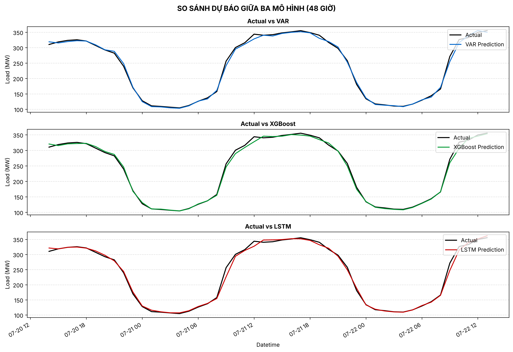
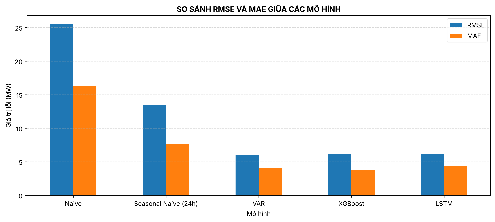
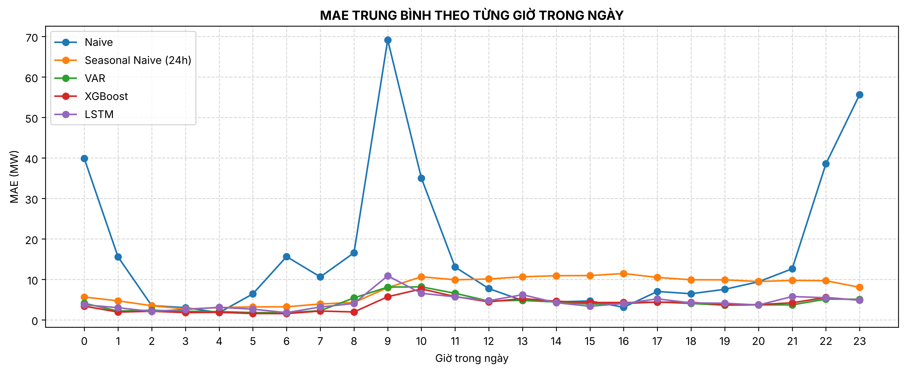

# Mục 9 và 10. Walk-forward và so sánh mô hình — Bao Dinh

## Mục 9. Walk-forward dùng chung

Hàm `backtest.walk_forward(fit_fn, predict_fn, scaled, start, end, refit_every=None, scaler=None, train_end=None)`:

- Lần học đầu chỉ dùng dữ liệu trước `start`, hoặc trước `train_end` nếu muốn mô hình chỉ học trên train.
- Mỗi giờ $t$ trong `[start, end)`, `predict_fn` chỉ nhận lịch sử `scaled.iloc[:t]`, tức các giá trị **thật** đến giờ $t-1$, rồi dự báo load giờ $t$ (một bước).
- `refit_every=None`: không học lại trên test. `refit_every=168`: học lại mỗi tuần trên toàn bộ lịch sử đã qua.
- Kết quả là DataFrame `actual`, `prediction` theo `Datetime`; truyền `scaler` thì đổi về MW.

Khác với chia train/test một lần rồi dự báo cả đoạn test từ một mốc: ở đây mỗi giờ test được dự báo từ đúng những gì đã biết tới lúc đó, giống cách vận hành thật, và sai số không bị cộng dồn qua nhiều bước.

## Mục 10. Luật so sánh

Để công bằng, bảng chính dùng **cùng một luật** cho cả ba mô hình:

| Hạng mục | Luật chung |
|---|---|
| Dữ liệu học | Chỉ train (18.412 giờ, đến 06/02/2014 03:00) |
| Chọn cấu hình | Chỉ dùng validation (3.946 giờ) |
| Trên test | Không học lại; mỗi giờ dự báo 1 bước từ lịch sử thật |
| Tập test | Cùng 3.946 giờ, 20/07/2014 14:00 đến 31/12/2014 23:00 |
| Chuẩn hóa, sai số | Cùng scaler fit trên train; cùng công thức RMSE, MAE, MAPE trên MW |

Cách huấn luyện từng mô hình (`data/processed/compare_protocol.csv`):

| Mô hình | Cách huấn luyện |
|---|---|
| VAR | VAR(26), p chọn theo BIC trên train; học một lần trên train |
| XGBoost | max_depth chọn trong {3, 5, 7, 9} trên validation; học trên train, early stopping theo validation (153 cây) |
| LSTM | patience chọn trong {5, 10} trên validation (trung bình 3 seed); xáo trộn cửa sổ train mỗi epoch; seed 42 |

## Bảng so sánh chính (`data/processed/compare_metrics.csv`)

| Mô hình | RMSE (MW) | MAE (MW) | MAPE (%) |
|---|---|---|---|
| Naive (giờ trước) | 25,50 | 16,34 | 8,78 |
| Seasonal naive 24h | 13,42 | 7,68 | 3,82 |
| VAR(26) | **6,07** | 4,11 | 2,06 |
| XGBoost | 6,17 | **3,81** | **1,89** |
| LSTM (seed 42) | 6,14 | 4,39 | 2,25 |

LSTM chạy 3 seed cho test RMSE 6,02 ± 0,11 MW (mục 8). VAR và XGBoost tất định nên không có dao động này.

Bảng phụ, bản có học lại mỗi 168 giờ của mục 6 và 7 (`compare_metrics_refit.csv`): VAR 6,05 / 4,06 / 2,03; XGBoost 6,07 / 3,71 / 1,86. Học lại hằng tuần chỉ cải thiện 0,02 đến 0,10 MW RMSE, nhỏ hơn khoảng cách giữa các seed của LSTM.

## Nhận xét

1. Cả ba mô hình đều tốt hơn rất nhiều so với hai baseline: RMSE khoảng 6 MW so với 13,42 MW của seasonal naive, tức giảm hơn một nửa.
2. Không có mô hình thắng tuyệt đối. VAR có RMSE thấp nhất (6,07), XGBoost có MAE và MAPE thấp nhất (3,81 MW, 1,89%), LSTM nằm giữa. Chênh lệch RMSE giữa ba mô hình (0,10 MW) nhỏ hơn dao động của LSTM khi đổi seed (±0,11 MW), nên về RMSE có thể xem là ngang nhau.
3. XGBoost sai ít ở phần lớn các giờ nhưng có vài giờ sai rất lớn. Lớn nhất là chiều 26/12/2014: lúc 16:00 thực tế 218,9 MW, XGBoost dự báo 141,0 MW, VAR 206,7 MW, LSTM 217,9 MW. Mô hình dựa nhiều vào `load_lag24` (cùng giờ ngày Giáng sinh, tải thấp) nên chậm thích nghi khi ngày hôm trước bất thường. Đây là lý do RMSE của XGBoost không thấp hơn dù MAE thấp nhất.
4. Cả ba sai nhiều nhất vào 9–10 giờ sáng, khi tải tăng nhanh. MAE lúc 10 giờ: VAR 8,17, XGBoost 7,65; LSTM cao nhất lúc 9 giờ (10,89). Cả ba sai ít nhất lúc 6 giờ (1,5–1,8 MW).
5. Nếu ưu tiên sai số trung bình mỗi giờ (MAE/MAPE), chọn XGBoost: chỉ cần vài giây để học, dễ giải thích (Câu 3). Nếu ưu tiên tránh sai lớn (RMSE), VAR là lựa chọn đơn giản và ổn định nhất. LSTM đạt cùng mức nhưng tốn thời gian huấn luyện hơn và nhạy với cách train.
